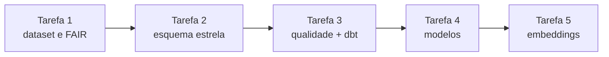
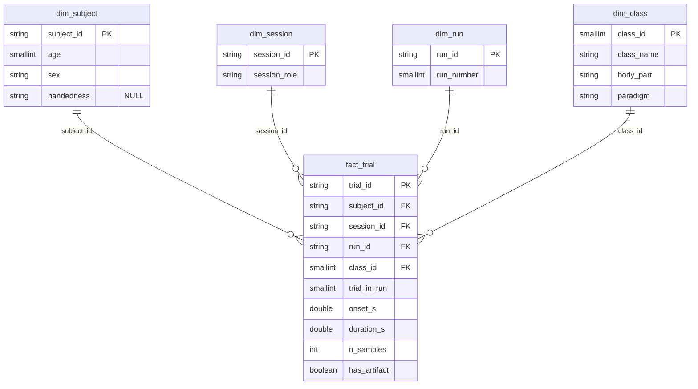
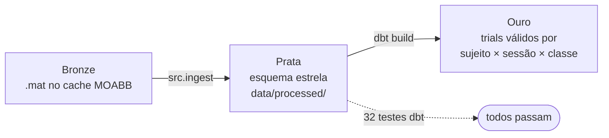
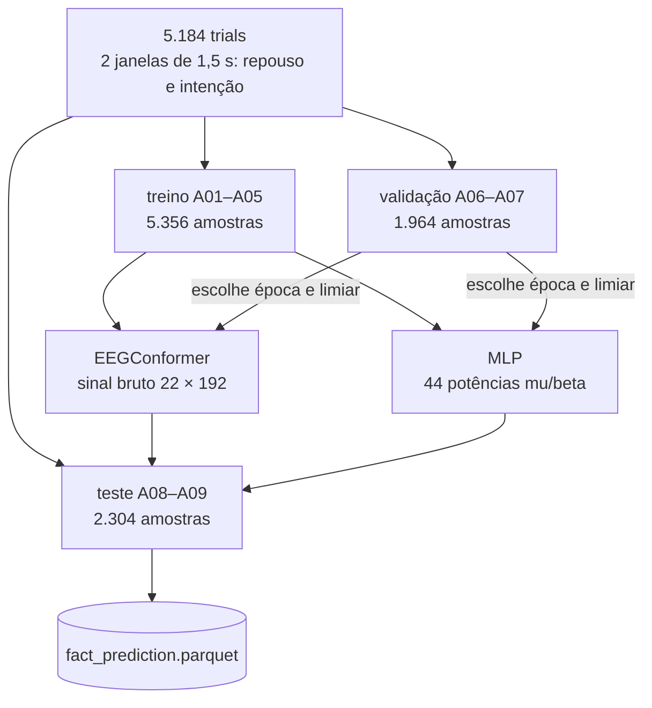
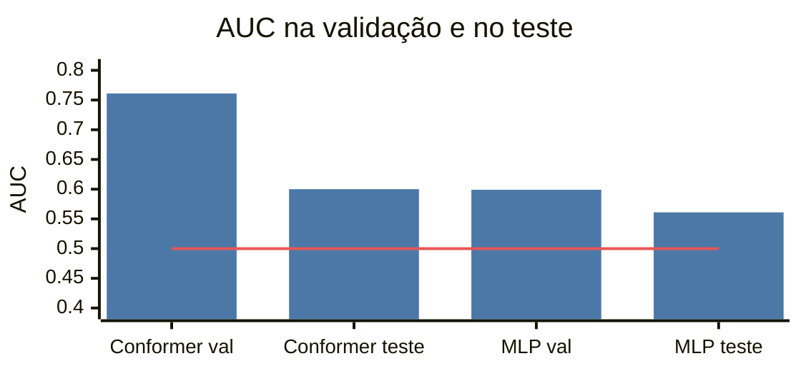
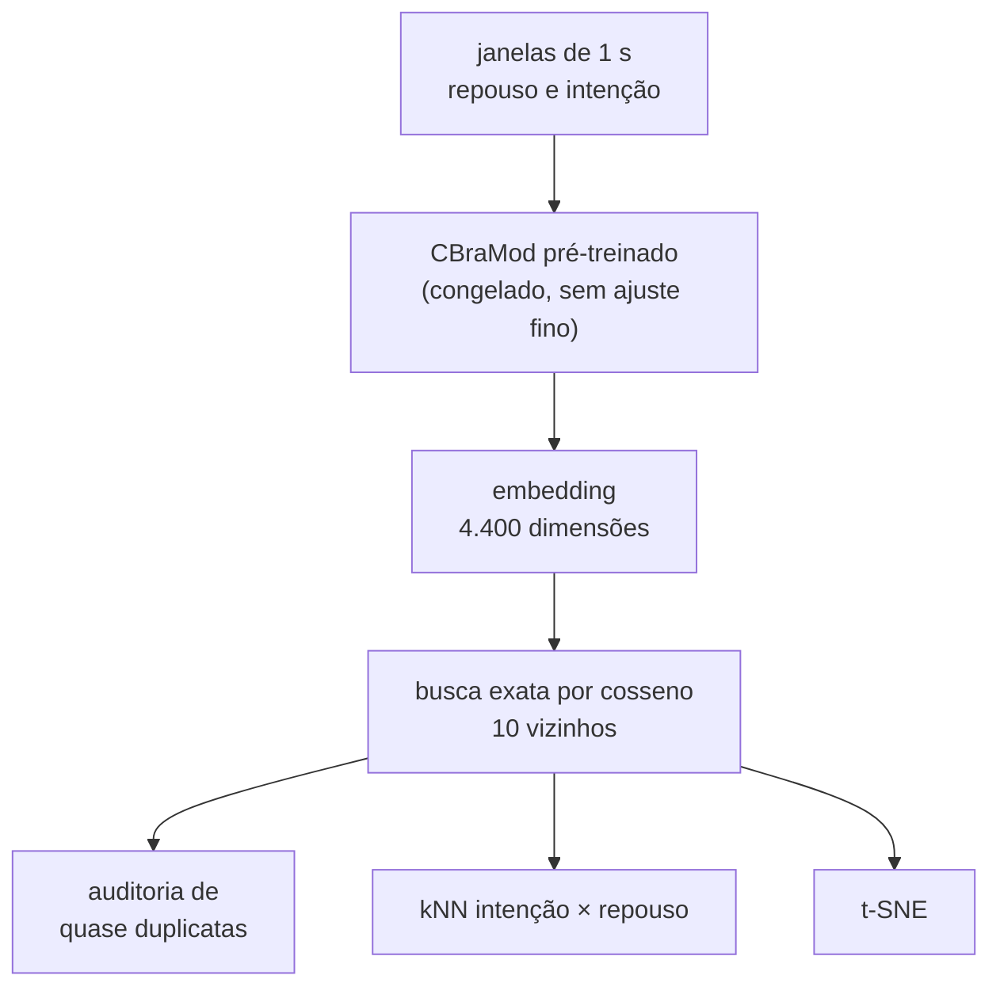
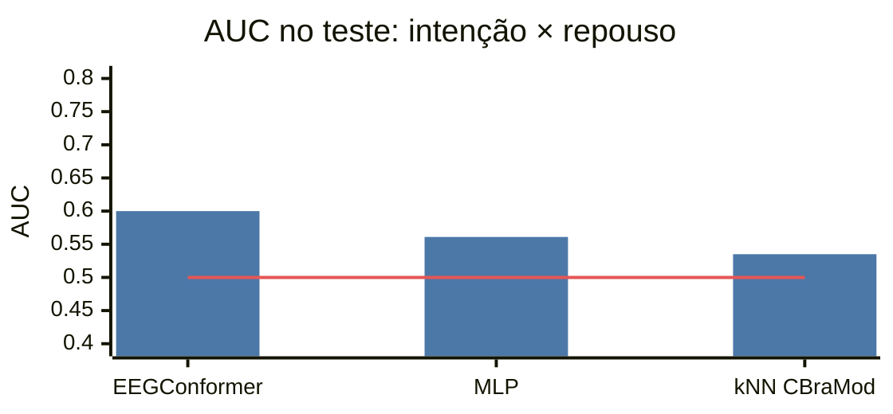

# Decodificação da intenção de movimento — BCI Competition IV 2a

EEG de imagética motora (4 classes, 9 sujeitos), carregado via
[MOABB](https://moabb.neurotechx.com/) / [braindecode](https://braindecode.org/).



## Como rodar

```powershell
uv sync --locked                                          # ambiente (Python 3.12)
uv run python -m src.ingest                               # Tarefa 2: gera data/processed/
uv run dbt build --project-dir dbt --profiles-dir dbt     # Tarefa 3: testes + camada Ouro
uv run python -m src.train                                # Tarefa 4: treina e gera predições
uv run python -m src.embed                                # Tarefa 5: embeddings e vizinhos
uv run jupyter notebook notebooks/                        # 01_dados_2a e 02_modelo_2a
```

Os Parquet já estão versionados, então o **notebook 02 roda offline**. Os scripts e o notebook 01
baixam o 2a via MOABB na 1ª vez (requer internet).

```
src/        ingest.py · train.py · embed.py
data/       processed/ (Prata) · gold/ (Ouro) · predictions/ · embeddings/
models/     eegconformer.pt · mlp.pt
dbt/        testes declarativos + modelo Ouro
notebooks/  01_dados_2a (Tarefas 1–3) · 02_modelo_2a (Tarefas 4–5)
```

---

## Tarefa 1 — Dataset e avaliação FAIR

| item | resumo |
|---|---|
| Fonte | BCI Competition IV 2a, TU Graz — [`BNCI2014_001`](https://moabb.neurotechx.com/docs/generated/moabb.datasets.BNCI2014_001.html), DOI [10.3389/fnins.2012.00055](https://doi.org/10.3389/fnins.2012.00055) |
| Licença | CC BY-ND 4.0 — derivados não podem ser redistribuídos, por isso o sinal **não** fica no Git |
| Sinal | 22 canais EEG + 3 EOG, 250 Hz, filtro 0,5–100 Hz |
| Classes | mão esquerda, mão direita, pés, língua |
| Tamanho | 9 sujeitos × 2 sessões × 288 trials = **5.184 trials** |
| Privacidade | desidentificado (`A01`–`A09`); risco residual de EEG fingerprinting |
| Pergunta | dá para decodificar a intenção de movimento só pelo EEG? |

**FAIR:** Findable 5 · Accessible 5 · Interoperable 4 (não é BIDS) · Reusable 3 (licença ND,
demografia mínima) → **média 4,25 / 5**.

**Limitações:** só 9 sujeitos saudáveis, 2 sessões, artefatos de EOG, sem lateralidade.

> O material da Aula 01 com o dataset anterior (eegmmidb) está em [`archive_aula01/`](archive_aula01/).

---

## Tarefa 2 — Camada analítica (esquema estrela)

Só os **metadados** dos trials (sem sinal) viram Parquet consultável com DuckDB.
Ingestão em lotes, um sujeito por vez: [`src/ingest.py`](src/ingest.py).



- **Grão:** 1 linha = 1 trial (5.184).
- **Nulo verdadeiro:** `handedness` é `NULL` (não existe na fonte).
- **CSV × Parquet:** Parquet **~6× menor** (54 vs 330 KiB) e agregação **~20× mais rápida**.

---

## Tarefa 3 — Qualidade, Medallion e testes



| métrica | resultado |
|---|---|
| Duplicatas | 0 |
| Completude | 100% (exceto `handedness`, 0%) |
| Regras de validade (18) | 0 violações |
| Trials com artefato | 488 de 5.184 (**9,4%**) → quarentena com `has_artifact = TRUE` |

**Correções:** `age`/`sex` passaram a ser lidos do `.mat`; `recording_day` removido (não existe
na fonte).

**Ambiente:** dependências fixadas em [`pyproject.toml`](pyproject.toml) + [`uv.lock`](uv.lock).

---

## Tarefa 4 — Modelo: intenção × repouso

**Pergunta:** o modelo detecta **se** a pessoa está imaginando um movimento, em sujeitos que nunca viu?



- **Janelas:** repouso = 1,5 s antes do cue; intenção = 1,5–3,0 s após o cue. Trials com artefato saem do treino e da validação.
- **EEGConformer** ([Song et al., 2023](https://doi.org/10.1109/TNSRE.2022.3230250)): convolução + Transformer.
- **MLP:** log da potência mu (8–12 Hz) e beta (13–30 Hz) por canal.
- **Contra overfitting:** z-score só no treino, dropout 0,5, L2, parada antecipada pela AUC de validação.

### Resultados

AUC (área sob a curva ROC; 0,5 = acaso):



Teste (A08–A09), limiar escolhido na validação:

| modelo | limiar | sensibilidade | especificidade | acurácia |
|---|---|---|---|---|
| **EEGConformer** | 0,14 | 78,0% | 37,2% | **57,6%** |
| MLP | 0,46 | 74,3% | 35,8% | 55,0% |

| pergunta (p corrigido por Holm) | p |
|---|---|
| Conformer separa melhor que MLP? (DeLong) | **0,018** ✔ |
| Acerto muda entre A08 (61%) e A09 (54%)? | **0,002** ✔ |
| Acerto muda com membro imaginado ou artefato? | 0,36 ✘ |

**Leitura:** o EEGConformer é melhor, mas a AUC cai de 0,76 na validação para 0,60 no teste —
**domain shift entre pessoas**. Limitações: só 2 sujeitos de teste, saída não calibrada.

---

## Tarefa 5 — Embeddings e busca de vizinhos

**Ideia:** usar um modelo de fundação de EEG **congelado** e ver se amostras parecidas ficam perto.



- **Modelo:** [CBraMod](https://arxiv.org/abs/2412.07236) (ICLR 2025), pré-treinado no TUEG, que
  **não contém o 2a**. Pesos [`braindecode/cbramod-pretrained`](https://huggingface.co/braindecode/cbramod-pretrained).
- **Busca:** scikit-learn, conferida no DuckDB (`array_cosine_similarity`) — com ~10 mil vetores
  a busca exata basta.
- **Saídas:** `fact_embedding.parquet`, `fact_neighbor.parquet`, `pares_vizinhos.png`
  (vetores só locais, ~180 MB).

### Resultados

| verificação | resultado |
|---|---|
| Quase duplicatas (cosseno > 0,99) | **0** (maior: 0,55) |
| Cópias exatas (hash) | **0** |
| Vizinhos do mesmo sujeito (acaso 11%) | **25,4%** |
| Vizinhos com a mesma janela (acaso 50%) | 52,3% |
| kNN intenção × repouso, AUC no teste | 0,535 |

O embedding **agrupa por pessoa**, não por tarefa:


E não separa intenção de repouso — fica abaixo dos modelos supervisionados:



Amostras de teste (—) ao lado do 1º vizinho no treino (--): o vizinho mais parecido de um repouso é uma intenção.


**Leitura:**

- ✔ **Sem vazamento** entre treino e teste.
- ✔ O agrupamento por sujeito mede o **EEG fingerprinting** (Tarefa 1) e explica o domain shift (Tarefa 4).
- ✘ Não captura a dessincronização mu/beta da imagética: o pré-treino não tem rótulo de tarefa e o
  modelo foi usado sem ajuste fino.

**Limitações:** só 2 sujeitos de teste, k = 10 fixo, janela de 1 s, montagem diferente do pré-treino.
