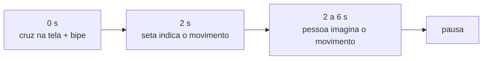
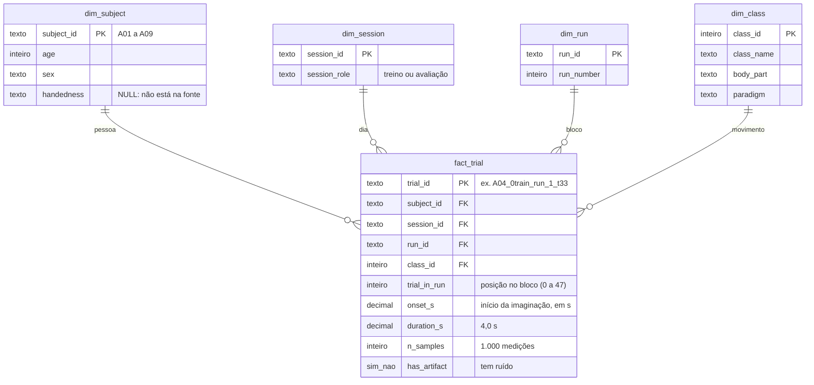
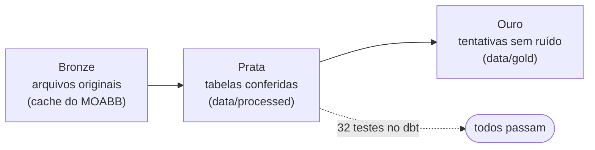
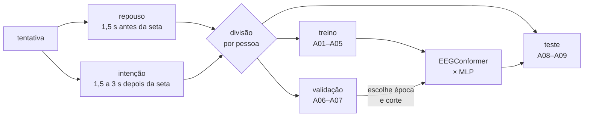
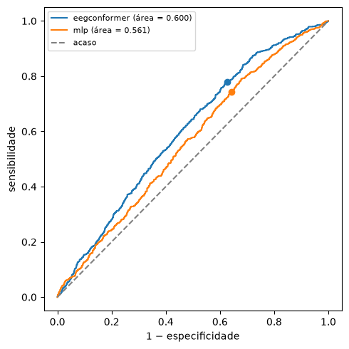
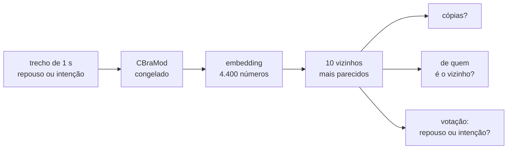
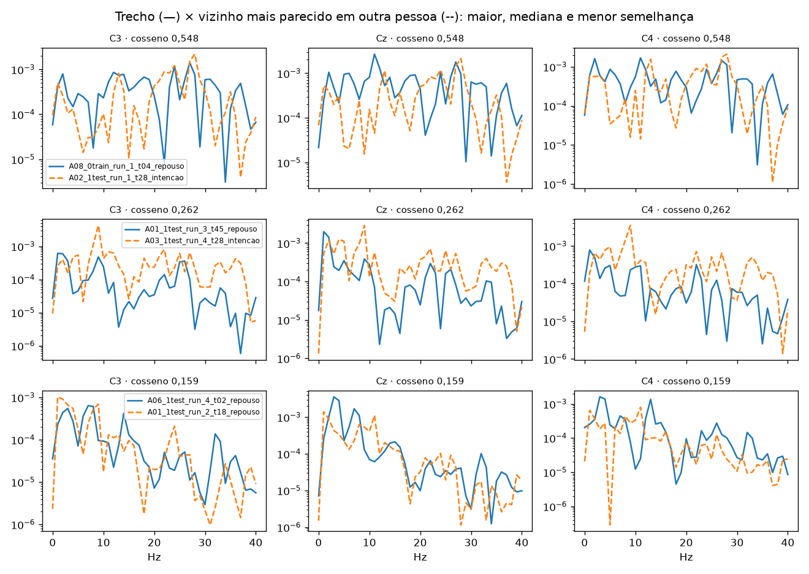
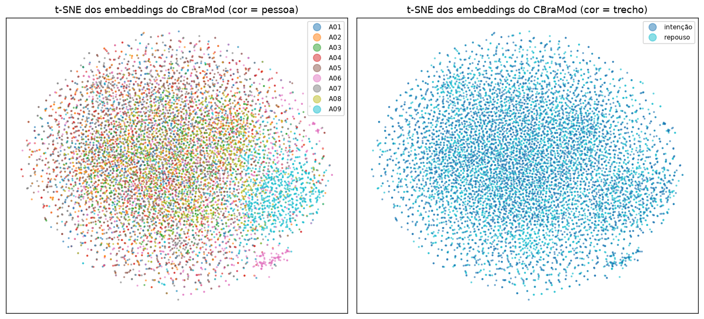
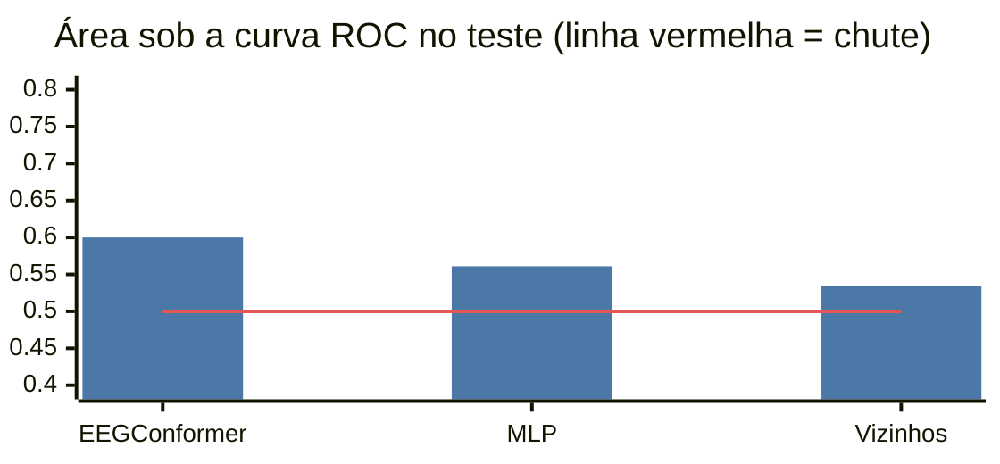
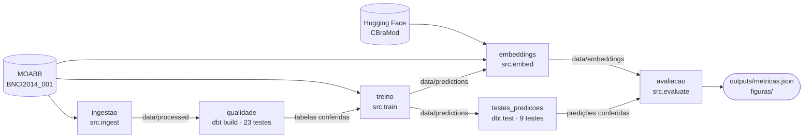

# Decodificação da intenção de movimento — BCI Competition IV 2a

Sinal cerebral (eletroencefalograma) de 9 pessoas imaginando movimentos. Objetivo: detectar, só
pelo sinal, que a pessoa **quer** se mexer.

| etapa | o que faz | seção |
|---|---|---|
| Tarefa 1 | conhecer os dados | [ficha técnica](#tarefa-1--conhecer-os-dados) |
| Tarefa 2 | organizar em tabelas | [esquema estrela](#tarefa-2--organizar-em-tabelas) |
| Tarefa 3 | checar a qualidade | [testes](#tarefa-3--checar-a-qualidade) |
| Tarefa 4 | redes neurais e avaliação | [modelos](#tarefa-4--redes-neurais-e-avaliação) |
| Tarefa 5 | embeddings | [vizinhos](#tarefa-5--embeddings) |
| Tarefa 6 | pipeline automático e registrado | [mapa do pipeline](#tarefa-6--mapa-do-pipeline) |
| | o que não se pode concluir | [LIMITACOES.md](LIMITACOES.md) |

## Como reproduzir

```powershell
git clone https://github.com/kafb04/data-engineering-multimodal-ai.git
cd data-engineering-multimodal-ai
uv sync --locked                    # instala o Python 3.12 e as bibliotecas nas versões travadas
uv run python run_pipeline.py       # roda tudo, do download dos dados às figuras
```

| requisito | detalhe |
|---|---|
| Sistema | Windows, Linux ou macOS. Só precisa do [uv](https://docs.astral.sh/uv/); sem Docker |
| Hardware | só CPU (sem placa de vídeo) |
| Internet | na primeira execução: ~750 MB de sinal (MOABB, em `~/mne_data`) e os pesos do CBraMod (Hugging Face) |
| Tempo | cerca de 52 min em um notebook comum; 41 min são o treino |

**Sem rodar nada**, os resultados já estão no repositório: modelos treinados (`models/`), predições
e tabelas (`data/`), números ([`outputs/metricas.json`](outputs/metricas.json)), figuras
(`figuras/`) e o registro da execução que os produziu (`outputs/execucoes/`).

---

## Tarefa 1 — Conhecer os dados

> **Pergunta:** este conjunto de dados serve para estudar a intenção de movimento? O que ele tem,
> e com quais limites?

### Ficha técnica

| item | resumo |
|---|---|
| Nome | BCI Competition IV 2a (`BNCI2014_001` no [MOABB](https://moabb.neurotechx.com/)) |
| Fonte | Universidade de Tecnologia de Graz. Tangermann et al. (2012), [DOI 10.3389/fnins.2012.00055](https://doi.org/10.3389/fnins.2012.00055) |
| Licença | **CC BY-ND 4.0**: pode usar e citar, mas não distribuir versão modificada. Por isso o sinal **não fica no repositório**: o MOABB baixa na primeira execução |
| Tamanho | 9 pessoas × 2 dias × 288 tentativas = **5.184 tentativas**, 12 por classe em cada bloco (equilibradas) |
| Privacidade | anônimo (A01–A09, só idade e sexo). Risco que sobra: o sinal cerebral funciona como impressão digital, mas reconhecer alguém exigiria outra gravação da mesma pessoa |
| Aplicação | interface cérebro-computador para reabilitação e comunicação de pessoas com AVC, ELA ou lesão medular |

### Variáveis

| variável | formato | valores |
|---|---|---|
| Sinal cerebral (EEG) | 22 eletrodos, em volts | ±100 µV, **250 medições por segundo**, filtrado entre 0,5 e 100 Hz |
| Movimento dos olhos (EOG) | 3 eletrodos | usado para identificar piscadas |
| Classe | rótulo da tentativa | mão esquerda, mão direita, pés, língua |
| Dia | 2 por pessoa | treino e avaliação, em dias diferentes |
| Pessoa | identificador | A01 a A09 |

### Uma tentativa




À esquerda, o sinal dos eletrodos C3, Cz e C4 (lado esquerdo, centro e lado direito da cabeça, sobre
a área do movimento). À direita, as 4 classes, equilibradas.

### Uso em aprendizado de máquina

| item | resumo |
|---|---|
| **Entrada** | 22 eletrodos × 4 s (1.000 medições), com foco em C3, Cz e C4 e nos ritmos mu (8–12 Hz) e beta (13–30 Hz) |
| **Alvo** | qual movimento a pessoa imagina |
| **Métodos conhecidos** | CSP + LDA, classificadores de Riemann e redes neurais (EEGNet, ShallowConvNet), todos no [braindecode](https://braindecode.org/) |

### Dados abertos (FAIR)

| critério | nota | por quê |
|---|:---:|---|
| Fácil de encontrar | 5 | DOI e identificador fixo no BNCI Horizon e no MOABB |
| Fácil de acessar | 5 | download aberto, sem cadastro; uma linha de código no MOABB |
| Fácil de combinar | 4 | formato aberto (GDF), mas fora do padrão BIDS e sem posição dos eletrodos |
| Fácil de reutilizar | 3 | origem bem documentada, mas a licença proíbe versões modificadas e falta a mão dominante |
| **Média** | **4,25** | |

### Limitações

- **Só 9 pessoas**, todas saudáveis: pouco para generalizar entre pessoas e nada sobre pacientes.
- **Só 2 dias** por pessoa: pouco para estudar a estabilidade ao longo do tempo.
- **Piscadas atrapalham** o sinal: 9,4% das tentativas vêm marcadas com ruído.
- **Faltam dados da pessoa**: não há mão dominante, que muda a assimetria esperada entre os lados.
- **Laboratório controlado**, com tentativas curtas: tende a superestimar o acerto no uso real.

---

## Tarefa 2 — Organizar em tabelas

> **Objetivo:** guardar as informações de cada tentativa (sem o sinal) em tabelas fáceis de consultar.

### Esquema estrela

Uma tabela central (**fato**) com uma linha por tentativa, ligada a 4 tabelas de descrição
(**dimensões**). Gerado por [`src/ingest.py`](src/ingest.py), uma pessoa por vez.



**Grão:** 1 linha da fato = 1 tentativa (5.184 linhas).

### Decisões

| decisão | por quê |
|---|---|
| Estrela, com cada dimensão em uma tabela só | as dimensões são pequenas (2 a 9 linhas): um join por dimensão basta |
| Chaves em texto (`A01`, `0train`, `run_0`) | a fonte é fechada e as chaves são estáveis e legíveis |
| Dado ausente fica `NULL` | a mão dominante não está na fonte; nada de valor falso como `-1` |
| Sinal fora do Parquet | só metadados e rótulos entram; o sinal fica no cache do MOABB (licença) |

### Resultado: CSV × Parquet

| mesma tabela fato | CSV | Parquet |
|---|---|---|
| Tamanho | 329,8 KiB | **54,1 KiB** (6× menor) |
| Consulta no DuckDB | 1× | **20× mais rápida** |

---

## Tarefa 3 — Checar a qualidade

> **Pergunta:** as tabelas estão corretas e completas? O que fazer com o que está errado?

### Camadas



Os testes ([`dbt/models/schema.yml`](dbt/models/schema.yml)) conferem chaves únicas e não nulas,
ligações entre tabelas e valores permitidos.

### Resultado

| verificação | resultado |
|---|---|
| Linhas repetidas | **nenhuma** |
| Campos preenchidos | **100%**, exceto mão dominante (0%) |
| Valores inválidos (18 regras) | **nenhum** |
| Tentativas com ruído | 488 de 5.184 (**9,4%**) |

### Problemas encontrados e decisões

| problema | decisão |
|---|---|
| Idade e sexo vinham vazios, mas estão na fonte | **corrigido**: a ingestão passou a ler os dois |
| A marcação de ruído era descartada | **quarentena**: as 488 tentativas ficam na Prata marcadas (`has_artifact`) e o Ouro separa as válidas |
| `onset_s` era descrito como início da tentativa | **corrigido**: é o início da imaginação (2 s depois) |
| Mão dominante 0% preenchida | **mantido** como `NULL`: não está na fonte |
| Coluna de data vazia e na tabela errada | **removida**: a fonte não traz a data |

### Limitações

- **A quarentena é desigual:** A06 perde 24,7% das tentativas; A01, só 3,8%. Sem elas, as classes
  deixam de ser equilibradas.
- **A marcação de ruído é dos autores** do conjunto e não foi refeita aqui.
- **As regras olham os metadados, não o sinal:** um eletrodo ruidoso não aparece.

---

## Tarefa 4 — Redes neurais e avaliação

> **Pergunta:** só pelo sinal, um modelo sabe se a pessoa está em **repouso** ou com **intenção** de
> se mexer, mesmo em pessoas que ele **nunca viu**?

### Como



| | EEGConformer | Perceptron multicamadas (MLP) |
|---|---|---|
| **Entrada** | o sinal inteiro | só a força dos ritmos cerebrais |
| **Arquitetura** | convolução + atenção | camadas totalmente ligadas |

Os dois são treinados do zero com os rótulos (treino supervisionado) e depois usados para prever
(inferência). Comparar os dois mostra se ler o sinal completo ajuda.

| cuidado | como |
|---|---|
| Não vazar o teste | **z-score** (média 0, desvio 1) calculado só com o treino |
| Não decorar o treino | **dropout**, penalização dos pesos e **parada antecipada** |
| Comparar com rigor | **McNemar** (acertos), **DeLong** (área ROC), **qui-quadrado** (grupos), com correção de **Holm** |

### Resultado 1 — Treinar demais faz o modelo decorar


O erro no treino (azul) cai sempre; o da validação (laranja) não acompanha e, no MLP, sobe.
**Guardamos a época em que a validação ia melhor** (linha tracejada).

### Resultado 2 — O EEGConformer é melhor, mas pouco acima do chute



Quanto mais longe da diagonal tracejada (chute), melhor. Área: **0,60** × 0,56 (DeLong, p = 0,018 já
corrigido por Holm).

| no teste | intenções detectadas | repousos detectados | acurácia |
|---|---|---|---|
| **EEGConformer** | 78,0% | 37,2% | **57,6%** |
| MLP | 74,3% | 35,8% | 55,0% |

### Resultado 3 — O corte escolhido na validação faz o modelo pender para "intenção"

O modelo dá uma nota de 0 a 1 para a chance de ser intenção. Acima do **corte**, ele responde
"intenção"; abaixo, "repouso". Quanto menor o corte, mais "intenção" ele responde.


Cada quadrado separa as 1.152 tentativas de cada classe pelo que o modelo respondeu; **os acertos
estão na diagonal, em negrito**.

| EEGConformer no teste | intenções certas | repousos certos | acerto total |
|---|---|---|---|
| corte padrão (0,50) | 62% | 53% | 57,3% |
| corte da validação (0,14) | **78%** | **37%** | 57,6% |

- **Baixar o corte só troca um erro pelo outro:** acha mais intenções, mas confunde mais repousos, e o acerto total não muda.
- **O corte da validação não serve no teste:** o 0,14 era o corte que mais acertava as duas classes em A06–A07; em A08–A09, faz o modelo dizer "intenção" em 70% das vezes. **Cada pessoa precisaria do seu corte.**

### Resposta

**Pouco.** A área ROC cai de **0,76** na validação para **0,60** no teste, e o acerto muda entre as
duas pessoas de teste (61% × 54%, p = 0,002 corrigido), mas não com o movimento nem com o ruído.
**Cada cérebro é diferente** (domain shift): o que pesa é a pessoa.

---

## Tarefa 5 — Embeddings

> **Pergunta:** um modelo pré-treinado em muitos sinais cerebrais (**CBraMod**) ajuda a entender a
> Tarefa 4? Há **cópias** entre treino e teste? Ele separa **repouso** de **intenção**?

### Como



- **Embedding:** lista de números que resume o trecho. Trechos parecidos têm embeddings próximos (**vizinhos**).
- **Congelado:** os pesos não mudam, então mede só o que o modelo já sabia do pré-treino, feito sem estes dados.
- **Busca exata:** cada trecho é comparado com todos os outros (10 mil trechos levam segundos).

### Resultado 1 — Nenhuma cópia entre treino e teste


Semelhança de cada trecho de teste com o vizinho mais parecido. Nenhum passa de 0,55; cópia seria
perto de **0,99** (linha tracejada).



Inspeção dos pares mais, médio e menos parecidos (azul: teste; laranja: vizinho no treino). Mesmo o
par mais parecido (1ª fileira) é de pessoas e classes diferentes: um repouso de A08 ao lado de uma
intenção de A02.

### Resultado 2 — O modelo agrupa por pessoa, não por intenção



Embeddings projetados em 2 dimensões (t-SNE). À esquerda, cor = pessoa: A09 (amarelo) forma um grupo
próprio. À direita, cor = classe: repouso e intenção se misturam.

| o vizinho é... | acaso | obtido |
|---|---|---|
| da **mesma pessoa** | 11% (1 em 9) | **25,4%** |
| da **mesma classe** | 50% | 52,3% |

### Resultado 3 — Votar pelos vizinhos é pior que os modelos da Tarefa 4

Cada trecho de teste recebe a classe da maioria dos seus 10 vizinhos no treino.



### Resposta

- **Sem cópias:** os resultados da Tarefa 4 não foram inflados.
- **O modelo reconhece de quem é o sinal** (impressão digital cerebral): isso explica a queda da Tarefa 4.
- **Não reconhece a intenção:** foi pré-treinado sem saber o que a pessoa fazia e usado congelado.

---

## Tarefa 6 — Mapa do pipeline

> **Objetivo:** o projeto roda sozinho, do dado bruto às figuras, e registra o que fez.

### DAG

Cada caixa é uma etapa; a seta significa "depende de". Cilindros são fontes externas.



| etapa | comando | entradas | saídas | depende de |
|---|---|---|---|---|
| `ingestao` | `python -m src.ingest` | sinal (MOABB) | `data/processed/` (5 tabelas) | — |
| `qualidade` | `dbt build --exclude source:predictions` | `data/processed/` | `data/gold/`; 23 testes | `ingestao` |
| `treino` | `python -m src.train` | sinal, `fact_trial` | `models/*.pt`, `data/predictions/` | `qualidade` |
| `testes_predicoes` | `dbt test --select source:predictions` | `data/predictions/`, `fact_trial` | 9 testes | `treino` |
| `embeddings` | `python -m src.embed` | sinal, `fact_trial`, `fact_prediction`, pesos do CBraMod | `data/embeddings/`, `figuras/pares_vizinhos.png` | `treino` |
| `avaliacao` | `python -m src.evaluate` | todas as tabelas | `outputs/metricas.json`, `figuras/` | `testes_predicoes`, `embeddings` |

Os 32 testes do dbt rodam em dois momentos: os das tabelas de entrada **antes** de treinar (dado
ruim não chega ao modelo) e os da tabela de predições **depois**, porque ela só existe após o treino.

### Orquestração

Um script só com a biblioteca padrão do Python ([`run_pipeline.py`](run_pipeline.py)) faz o papel
do orquestrador: **coordena** (ordem e falhas) e **registra** (o que rodou, com quê e o que saiu).

```powershell
uv run python run_pipeline.py                     # tudo, na ordem do DAG
uv run python run_pipeline.py embeddings avaliacao   # refaz só as etapas nomeadas
```

| função | como |
|---|---|
| Ordem | o DAG é declarado em um dicionário; a ordem sai da ordenação topológica (`graphlib`) |
| Falha | a etapa fica `falhou`; as que dependem dela ficam `nao_rodou`; as outras seguem |
| Reprocessar | basta nomear as etapas; o resto vale o que já está no disco |
| Registro | um JSON por etapa em `outputs/execucoes/`, com `sha256` de cada entrada e saída |

**Por que não Airflow ou Dagster:** são 6 etapas em lote, rodadas uma vez, em uma máquina. Agenda,
retentativas e painel não seriam usados, e o Airflow exigiria Linux ou Docker.

### Registro de uma execução completa

Execução do zero em 16/11/2026 (Windows 11, Python 3.12.13, só CPU), com as pastas `data/`,
`models/`, `figuras/` e `outputs/` apagadas antes. Fica em
[`outputs/execucoes/`](outputs/execucoes/):

| etapa | status | início | duração |
|---|---|---|---|
| `ingestao` | ok | 15:36:08 | 2 min 16 s |
| `qualidade` | ok | 15:38:25 | 47 s |
| `treino` | ok | 15:39:13 | 41 min 24 s |
| `testes_predicoes` | ok | 16:20:37 | 29 s |
| `embeddings` | ok | 16:21:06 | 6 min 14 s |
| `avaliacao` | ok | 16:27:21 | 1 min 02 s |

**Reproduziu byte a byte** as saídas da execução anterior (03/11/2026): tabelas, pesos dos dois
modelos, predições, vizinhos e `metricas.json` têm o mesmo `sha256`.

**Teste de falha:** com `fact_prediction.parquet` removido de propósito, `testes_predicoes` ficou
`falhou`, `avaliacao` ficou `nao_rodou` (motivo: `depende de ['testes_predicoes']`) e o comando
saiu com erro.

Cada registro guarda também o comando, a semente, o commit do código, a versão do Python e o
sistema. Consultam-se como qualquer tabela:

```sql
SELECT etapa, status, duracao_s, commit
FROM read_json_auto('outputs/execucoes/*.json') ORDER BY inicio;
```

### Versões

| item | versão |
|---|---|
| Dados | BCI Competition IV 2a, `BNCI2014_001` pelo `moabb==1.7.2` |
| Bibliotecas | fixadas em [`pyproject.toml`](pyproject.toml) e travadas em [`uv.lock`](uv.lock); Python 3.12 |
| Modelos treinados | EEGConformer e MLP do `braindecode==1.8.1`, semente 42; a versão vai em cada linha de `fact_prediction` (`model_version`) |
| Modelo pré-treinado | `braindecode/cbramod-pretrained` no commit `584cdc4` do Hugging Face |

### Limitações

- **Sem modo de amostra:** não há execução rápida com poucas pessoas; a divisão por pessoa é fixa.
- **Etapas em sequência:** `testes_predicoes` e `embeddings` poderiam rodar em paralelo, mas o ganho seria de segundos.
- **Reprodução exata só no mesmo ambiente:** ver [LIMITACOES.md](LIMITACOES.md).
