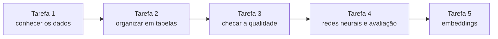
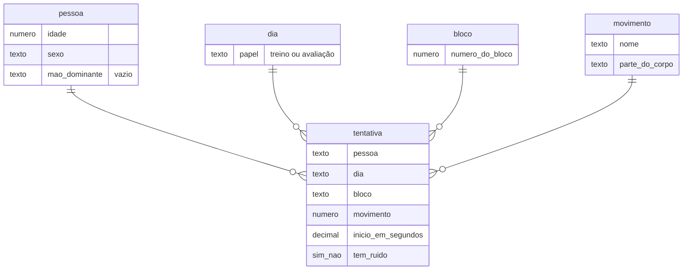
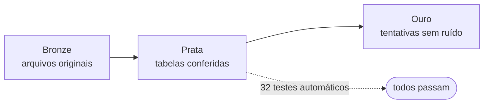
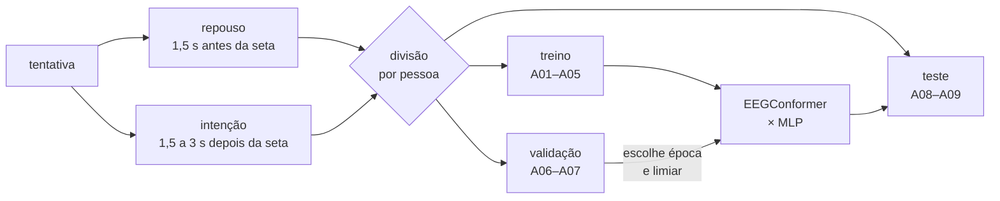
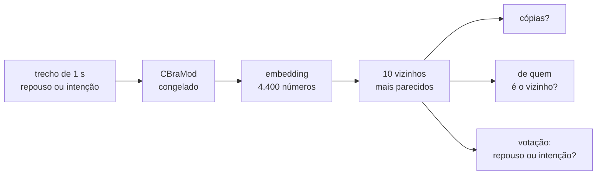
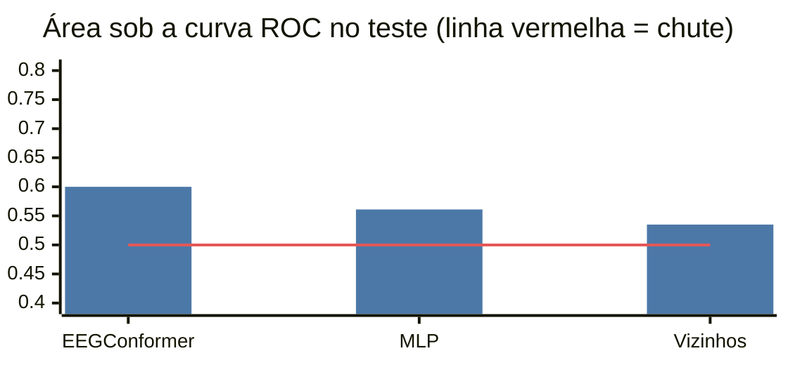

# Decodificação da intenção de movimento — BCI Competition IV 2a

Sinal cerebral (eletroencefalograma) de 9 pessoas imaginando movimentos. Objetivo: detectar, só
pelo sinal, que a pessoa **quer** se mexer.



## Como rodar

```powershell
uv sync --locked                                          # instala as bibliotecas
uv run python -m src.ingest                               # Tarefa 2
uv run dbt build --project-dir dbt --profiles-dir dbt     # Tarefa 3
uv run python -m src.train                                # Tarefa 4
uv run python -m src.embed                                # Tarefa 5
uv run jupyter notebook notebooks/                        # gráficos e análises
```

---

## Tarefa 1 — Conhecer os dados

| item | resumo |
|---|---|
| Fonte | Universidade de Tecnologia de Graz — [artigo](https://doi.org/10.3389/fnins.2012.00055) |
| Gravação | 22 eletrodos na cabeça + 3 em volta dos olhos, 250 medições por segundo |
| Movimentos imaginados | mão esquerda, mão direita, pés, língua |
| Tamanho | 9 pessoas × 2 dias × 288 tentativas = **5.184 tentativas** |
| Licença | proíbe redistribuir versões modificadas, por isso o sinal não fica no repositório |

**Dados abertos (nota de 1 a 5):** fácil de encontrar 5 · fácil de acessar 5 · fácil de combinar 4 ·
fácil de reutilizar 3 → **média 4,25**.

Sinal dos eletrodos C3, Cz e C4 (lado esquerdo, centro e lado direito da cabeça) em duas tentativas,
e as 4 classes, equilibradas:


**Limitações:** só 9 pessoas saudáveis, 2 dias de gravação, piscadas atrapalham o sinal.

---

## Tarefa 2 — Organizar em tabelas

As informações de cada tentativa (sem o sinal) ficam em uma tabela central ligada a 4 tabelas de descrição.



O formato Parquet ficou **6 vezes menor** que a planilha comum e as consultas, **20 vezes mais rápidas**.

---

## Tarefa 3 — Checar a qualidade



| verificação | resultado |
|---|---|
| Linhas repetidas | nenhuma |
| Valores inválidos (18 regras) | nenhum |
| Tentativas com ruído | 488 de 5.184 (**9,4%**), marcadas e deixadas de fora |

---

## Tarefa 4 — Redes neurais e avaliação

> **Pergunta:** só pelo sinal, um modelo sabe se a pessoa está em **repouso** ou com **intenção** de
> se mexer, mesmo em pessoas que ele **nunca viu**?

### Como



| | EEGConformer | Perceptron multicamadas (MLP) |
|---|---|---|
| **Entrada** | o sinal inteiro | só a força dos ritmos cerebrais |
| **Arquitetura** | convolução + atenção | camadas totalmente ligadas |

Os dois são treinados do zero com os rótulos (treino supervisionado) e depois usados para prever
(inferência). Comparar os dois mostra se ler o sinal completo ajuda.

| cuidado | como |
|---|---|
| Não vazar o teste | **z-score** (média 0, desvio 1) calculado só com o treino |
| Não decorar o treino | **dropout**, penalização dos pesos e **parada antecipada** |
| Comparar com rigor | **McNemar** (acertos), **DeLong** (área ROC), **qui-quadrado** (grupos), com correção de **Holm** |

### Resultado 1 — Treinar demais faz o modelo decorar


O erro no treino (azul) cai sempre; o da validação (laranja) não acompanha e, no MLP, sobe.
**Guardamos a época em que a validação ia melhor** (linha tracejada).

### Resultado 2 — O EEGConformer é melhor, mas pouco acima do chute


Quanto mais longe da diagonal tracejada (chute), melhor. Área: **0,60** × 0,56 (DeLong, p = 0,018).

| no teste | intenções detectadas | repousos detectados | acurácia |
|---|---|---|---|
| **EEGConformer** | 78,0% | 37,2% | **57,6%** |
| MLP | 74,3% | 35,8% | 55,0% |

### Resultado 3 — Os modelos respondem "intenção" quase sempre


Linha = verdade, coluna = resposta. À direita, com o limiar escolhido na validação, a maioria dos
repousos vira "intenção" (723 de 1.152 no EEGConformer): **o limiar que servia para A06–A07 não
serve para A08–A09.**

### Resposta

**Pouco.** A área ROC cai de **0,76** na validação para **0,60** no teste, e o acerto muda entre as
duas pessoas de teste (61% × 54%, p = 0,002), mas não com o movimento nem com o ruído.
**Cada cérebro é diferente** (domain shift): o que pesa é a pessoa.

---

## Tarefa 5 — Embeddings

> **Pergunta:** um modelo pré-treinado em muitos sinais cerebrais (**CBraMod**) ajuda a entender a
> Tarefa 4? Há **cópias** entre treino e teste? Ele separa **repouso** de **intenção**?

### Como



- **Embedding:** lista de números que resume o trecho. Trechos parecidos têm embeddings próximos (**vizinhos**).
- **Congelado:** os pesos não mudam, então mede só o que o modelo já sabia do pré-treino, feito sem estes dados.
- **Busca exata:** cada trecho é comparado com todos os outros (10 mil trechos levam segundos).

### Resultado 1 — Nenhuma cópia entre treino e teste


Semelhança de cada trecho de teste com o vizinho mais parecido. Nenhum passa de 0,55; cópia seria
perto de **0,99** (linha tracejada).


Inspeção dos pares mais, médio e menos parecidos (azul: teste; laranja: vizinho no treino). Mesmo o
par mais parecido (1ª fileira) é de pessoas e classes diferentes: um repouso de A08 ao lado de uma
intenção de A02.

### Resultado 2 — O modelo agrupa por pessoa, não por intenção


Embeddings projetados em 2 dimensões (t-SNE). À esquerda, cor = pessoa: A09 (amarelo) forma um grupo
próprio. À direita, cor = classe: repouso e intenção se misturam.

| o vizinho é... | acaso | obtido |
|---|---|---|
| da **mesma pessoa** | 11% (1 em 9) | **25,4%** |
| da **mesma classe** | 50% | 52,3% |

### Resultado 3 — Votar pelos vizinhos é pior que os modelos da Tarefa 4

Cada trecho de teste recebe a classe da maioria dos seus 10 vizinhos no treino.



### Resposta

- **Sem cópias:** os resultados da Tarefa 4 não foram inflados.
- **O modelo reconhece de quem é o sinal** (impressão digital cerebral): isso explica a queda da Tarefa 4.
- **Não reconhece a intenção:** foi pré-treinado sem saber o que a pessoa fazia e usado congelado.
