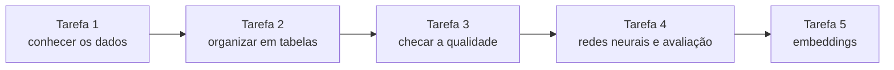
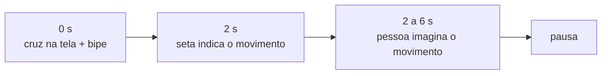
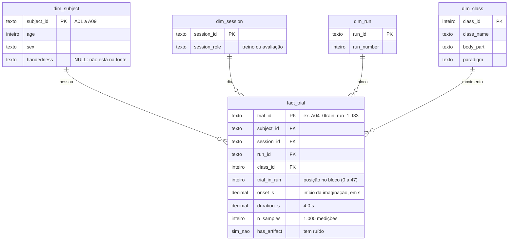
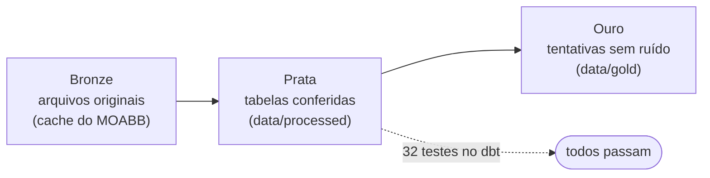
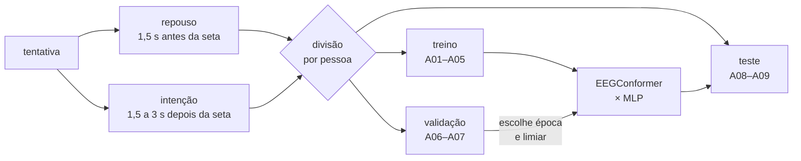
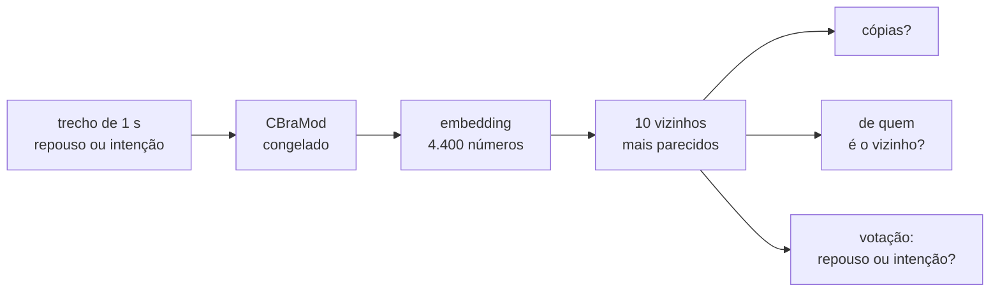
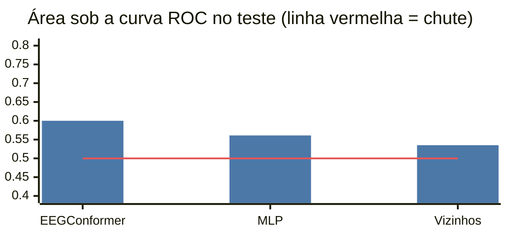

# Decodificação da intenção de movimento — BCI Competition IV 2a

Sinal cerebral (eletroencefalograma) de 9 pessoas imaginando movimentos. Objetivo: detectar, só
pelo sinal, que a pessoa **quer** se mexer.



## Como rodar

```powershell
uv sync --locked                                          # instala as bibliotecas
uv run python -m src.ingest                               # Tarefa 2
uv run dbt build --project-dir dbt --profiles-dir dbt     # Tarefa 3
uv run python -m src.train                                # Tarefa 4
uv run python -m src.embed                                # Tarefa 5
uv run jupyter notebook notebooks/                        # gráficos e análises
```

---

## Tarefa 1 — Conhecer os dados

> **Pergunta:** este conjunto de dados serve para estudar a intenção de movimento? O que ele tem,
> e com quais limites?

### Ficha técnica

| item | resumo |
|---|---|
| Nome | BCI Competition IV 2a (`BNCI2014_001` no [MOABB](https://moabb.neurotechx.com/)) |
| Fonte | Universidade de Tecnologia de Graz. Tangermann et al. (2012), [DOI 10.3389/fnins.2012.00055](https://doi.org/10.3389/fnins.2012.00055) |
| Licença | **CC BY-ND 4.0**: pode usar e citar, mas não distribuir versão modificada. Por isso o sinal **não fica no repositório**: o MOABB baixa na primeira execução |
| Tamanho | 9 pessoas × 2 dias × 288 tentativas = **5.184 tentativas**, 12 por classe em cada bloco (equilibradas) |
| Privacidade | anônimo (A01–A09, só idade e sexo). Risco que sobra: o sinal cerebral funciona como impressão digital, mas reconhecer alguém exigiria outra gravação da mesma pessoa |
| Aplicação | interface cérebro-computador para reabilitação e comunicação de pessoas com AVC, ELA ou lesão medular |

### Variáveis

| variável | formato | valores |
|---|---|---|
| Sinal cerebral (EEG) | 22 eletrodos, em volts | ±100 µV, **250 medições por segundo**, filtrado entre 0,5 e 100 Hz |
| Movimento dos olhos (EOG) | 3 eletrodos | usado para identificar piscadas |
| Classe | rótulo da tentativa | mão esquerda, mão direita, pés, língua |
| Dia | 2 por pessoa | treino e avaliação, em dias diferentes |
| Pessoa | identificador | A01 a A09 |

### Uma tentativa




À esquerda, o sinal dos eletrodos C3, Cz e C4 (lado esquerdo, centro e lado direito da cabeça, sobre
a área do movimento). À direita, as 4 classes, equilibradas.

### Uso em aprendizado de máquina

| item | resumo |
|---|---|
| **Entrada** | 22 eletrodos × 4 s (1.000 medições), com foco em C3, Cz e C4 e nos ritmos mu (8–12 Hz) e beta (13–30 Hz) |
| **Alvo** | qual movimento a pessoa imagina |
| **Métodos conhecidos** | CSP + LDA, classificadores de Riemann e redes neurais (EEGNet, ShallowConvNet), todos no [braindecode](https://braindecode.org/) |

### Dados abertos (FAIR)

| critério | nota | por quê |
|---|:---:|---|
| Fácil de encontrar | 5 | DOI e identificador fixo no BNCI Horizon e no MOABB |
| Fácil de acessar | 5 | download aberto, sem cadastro; uma linha de código no MOABB |
| Fácil de combinar | 4 | formato aberto (GDF), mas fora do padrão BIDS e sem posição dos eletrodos |
| Fácil de reutilizar | 3 | origem bem documentada, mas a licença proíbe versões modificadas e falta a mão dominante |
| **Média** | **4,25** | |

### Limitações

- **Só 9 pessoas**, todas saudáveis: pouco para generalizar entre pessoas e nada sobre pacientes.
- **Só 2 dias** por pessoa: pouco para estudar a estabilidade ao longo do tempo.
- **Piscadas atrapalham** o sinal: 9,4% das tentativas vêm marcadas com ruído.
- **Faltam dados da pessoa**: não há mão dominante, que muda a assimetria esperada entre os lados.
- **Laboratório controlado**, com tentativas curtas: tende a superestimar o acerto no uso real.

---

## Tarefa 2 — Organizar em tabelas

> **Objetivo:** guardar as informações de cada tentativa (sem o sinal) em tabelas fáceis de consultar.

### Esquema estrela

Uma tabela central (**fato**) com uma linha por tentativa, ligada a 4 tabelas de descrição
(**dimensões**). Gerado por [`src/ingest.py`](src/ingest.py), uma pessoa por vez.



**Grão:** 1 linha da fato = 1 tentativa (5.184 linhas).

### Decisões

| decisão | por quê |
|---|---|
| Estrela, com cada dimensão em uma tabela só | as dimensões são pequenas (2 a 9 linhas): um join por dimensão basta |
| Chaves em texto (`A01`, `0train`, `run_0`) | a fonte é fechada e as chaves são estáveis e legíveis |
| Dado ausente fica `NULL` | a mão dominante não está na fonte; nada de valor falso como `-1` |
| Sinal fora do Parquet | só metadados e rótulos entram; o sinal fica no cache do MOABB (licença) |

### Resultado: CSV × Parquet

| mesma tabela fato | CSV | Parquet |
|---|---|---|
| Tamanho | 329,8 KiB | **54,1 KiB** (6× menor) |
| Consulta no DuckDB | 1× | **20× mais rápida** |

---

## Tarefa 3 — Checar a qualidade

> **Pergunta:** as tabelas estão corretas e completas? O que fazer com o que está errado?

### Camadas



Os testes ([`dbt/models/schema.yml`](dbt/models/schema.yml)) conferem chaves únicas e não nulas,
ligações entre tabelas e valores permitidos.

### Resultado

| verificação | resultado |
|---|---|
| Linhas repetidas | **nenhuma** |
| Campos preenchidos | **100%**, exceto mão dominante (0%) |
| Valores inválidos (18 regras) | **nenhum** |
| Tentativas com ruído | 488 de 5.184 (**9,4%**) |

### Problemas encontrados e decisões

| problema | decisão |
|---|---|
| Idade e sexo vinham vazios, mas estão na fonte | **corrigido**: a ingestão passou a ler os dois |
| A marcação de ruído era descartada | **quarentena**: as 488 tentativas ficam na Prata marcadas (`has_artifact`) e o Ouro separa as válidas |
| `onset_s` era descrito como início da tentativa | **corrigido**: é o início da imaginação (2 s depois) |
| Mão dominante 0% preenchida | **mantido** como `NULL`: não está na fonte |
| Coluna de data vazia e na tabela errada | **removida**: a fonte não traz a data |

### Limitações

- **A quarentena é desigual:** A06 perde 24,7% das tentativas; A01, só 3,8%. Sem elas, as classes
  deixam de ser equilibradas.
- **A marcação de ruído é dos autores** do conjunto e não foi refeita aqui.
- **As regras olham os metadados, não o sinal:** um eletrodo ruidoso não aparece.

---

## Tarefa 4 — Redes neurais e avaliação

> **Pergunta:** só pelo sinal, um modelo sabe se a pessoa está em **repouso** ou com **intenção** de
> se mexer, mesmo em pessoas que ele **nunca viu**?

### Como



| | EEGConformer | Perceptron multicamadas (MLP) |
|---|---|---|
| **Entrada** | o sinal inteiro | só a força dos ritmos cerebrais |
| **Arquitetura** | convolução + atenção | camadas totalmente ligadas |

Os dois são treinados do zero com os rótulos (treino supervisionado) e depois usados para prever
(inferência). Comparar os dois mostra se ler o sinal completo ajuda.

| cuidado | como |
|---|---|
| Não vazar o teste | **z-score** (média 0, desvio 1) calculado só com o treino |
| Não decorar o treino | **dropout**, penalização dos pesos e **parada antecipada** |
| Comparar com rigor | **McNemar** (acertos), **DeLong** (área ROC), **qui-quadrado** (grupos), com correção de **Holm** |

### Resultado 1 — Treinar demais faz o modelo decorar


O erro no treino (azul) cai sempre; o da validação (laranja) não acompanha e, no MLP, sobe.
**Guardamos a época em que a validação ia melhor** (linha tracejada).

### Resultado 2 — O EEGConformer é melhor, mas pouco acima do chute


Quanto mais longe da diagonal tracejada (chute), melhor. Área: **0,60** × 0,56 (DeLong, p = 0,018).

| no teste | intenções detectadas | repousos detectados | acurácia |
|---|---|---|---|
| **EEGConformer** | 78,0% | 37,2% | **57,6%** |
| MLP | 74,3% | 35,8% | 55,0% |

### Resultado 3 — Os modelos respondem "intenção" quase sempre


Linha = verdade, coluna = resposta. À direita, com o limiar escolhido na validação, a maioria dos
repousos vira "intenção" (723 de 1.152 no EEGConformer): **o limiar que servia para A06–A07 não
serve para A08–A09.**

### Resposta

**Pouco.** A área ROC cai de **0,76** na validação para **0,60** no teste, e o acerto muda entre as
duas pessoas de teste (61% × 54%, p = 0,002), mas não com o movimento nem com o ruído.
**Cada cérebro é diferente** (domain shift): o que pesa é a pessoa.

---

## Tarefa 5 — Embeddings

> **Pergunta:** um modelo pré-treinado em muitos sinais cerebrais (**CBraMod**) ajuda a entender a
> Tarefa 4? Há **cópias** entre treino e teste? Ele separa **repouso** de **intenção**?

### Como



- **Embedding:** lista de números que resume o trecho. Trechos parecidos têm embeddings próximos (**vizinhos**).
- **Congelado:** os pesos não mudam, então mede só o que o modelo já sabia do pré-treino, feito sem estes dados.
- **Busca exata:** cada trecho é comparado com todos os outros (10 mil trechos levam segundos).

### Resultado 1 — Nenhuma cópia entre treino e teste


Semelhança de cada trecho de teste com o vizinho mais parecido. Nenhum passa de 0,55; cópia seria
perto de **0,99** (linha tracejada).


Inspeção dos pares mais, médio e menos parecidos (azul: teste; laranja: vizinho no treino). Mesmo o
par mais parecido (1ª fileira) é de pessoas e classes diferentes: um repouso de A08 ao lado de uma
intenção de A02.

### Resultado 2 — O modelo agrupa por pessoa, não por intenção


Embeddings projetados em 2 dimensões (t-SNE). À esquerda, cor = pessoa: A09 (amarelo) forma um grupo
próprio. À direita, cor = classe: repouso e intenção se misturam.

| o vizinho é... | acaso | obtido |
|---|---|---|
| da **mesma pessoa** | 11% (1 em 9) | **25,4%** |
| da **mesma classe** | 50% | 52,3% |

### Resultado 3 — Votar pelos vizinhos é pior que os modelos da Tarefa 4

Cada trecho de teste recebe a classe da maioria dos seus 10 vizinhos no treino.



### Resposta

- **Sem cópias:** os resultados da Tarefa 4 não foram inflados.
- **O modelo reconhece de quem é o sinal** (impressão digital cerebral): isso explica a queda da Tarefa 4.
- **Não reconhece a intenção:** foi pré-treinado sem saber o que a pessoa fazia e usado congelado.
