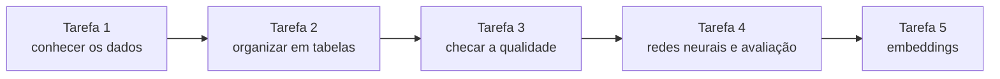
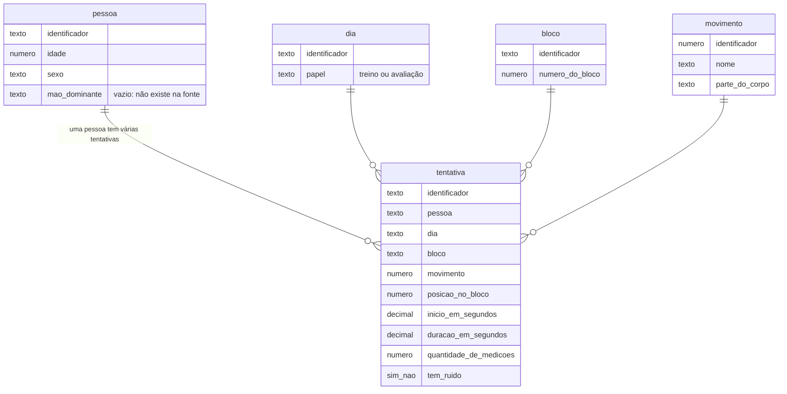
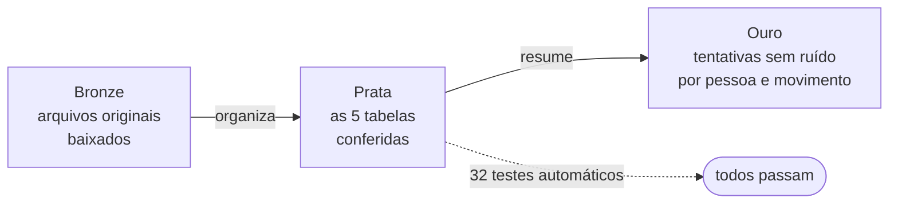
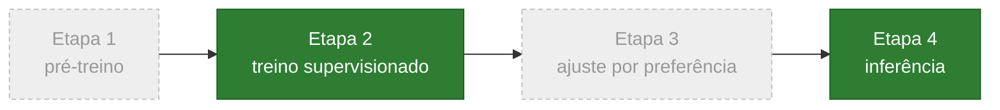
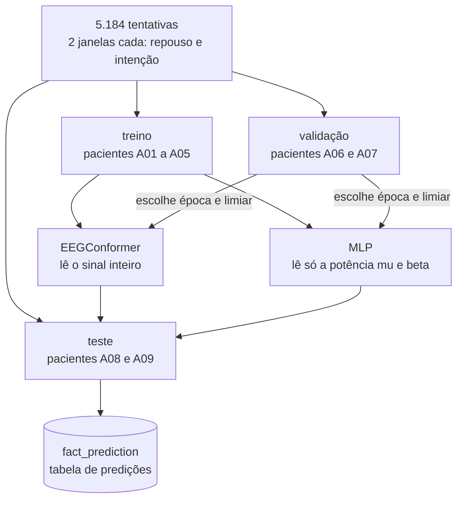
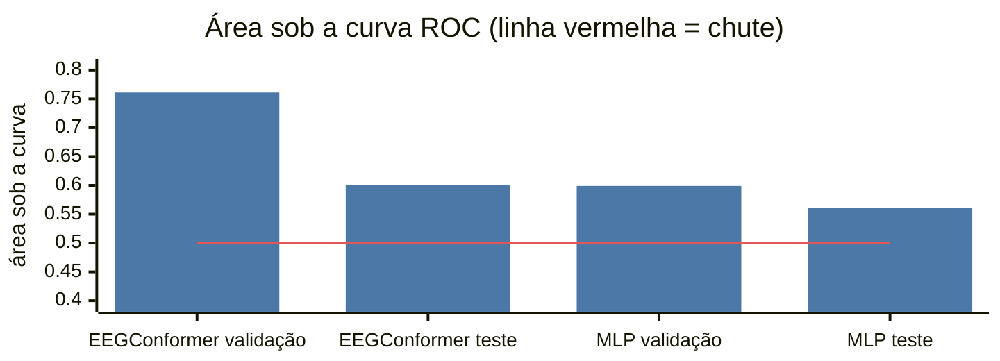
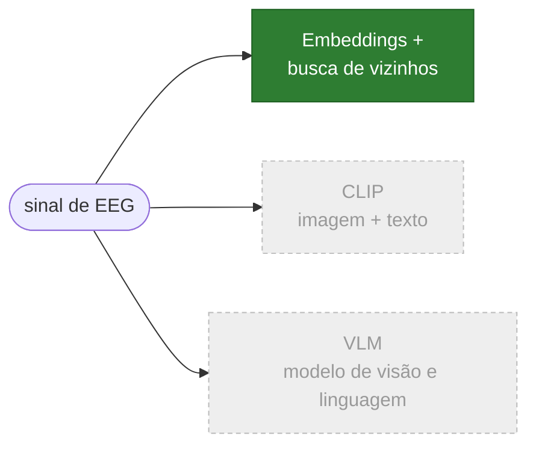
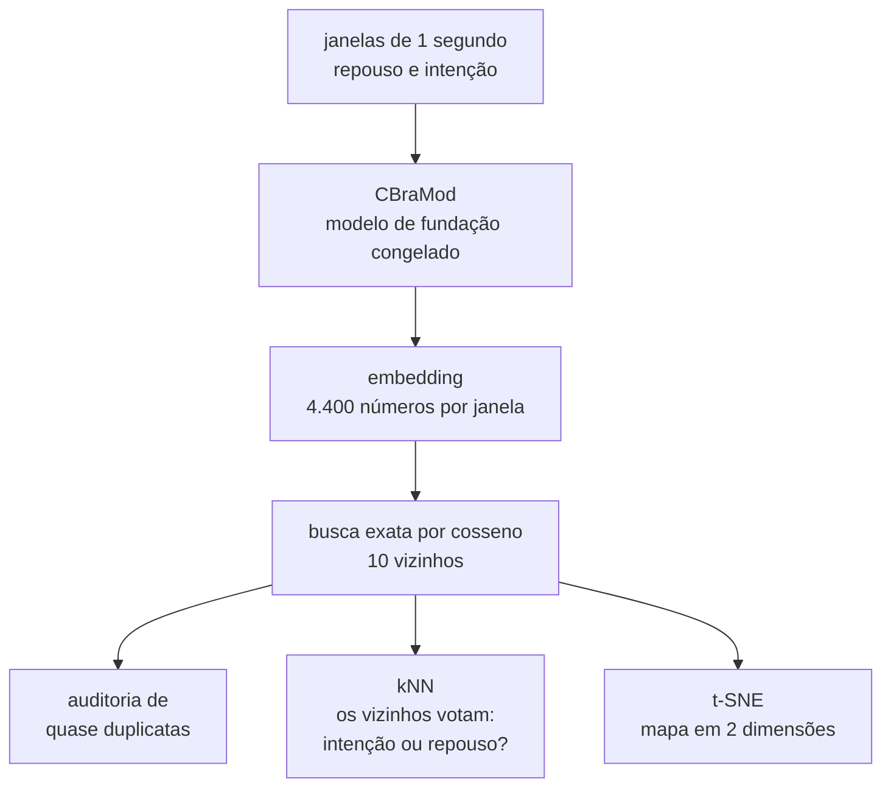
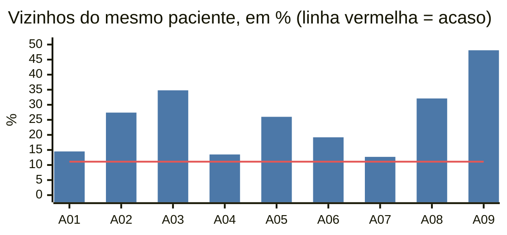
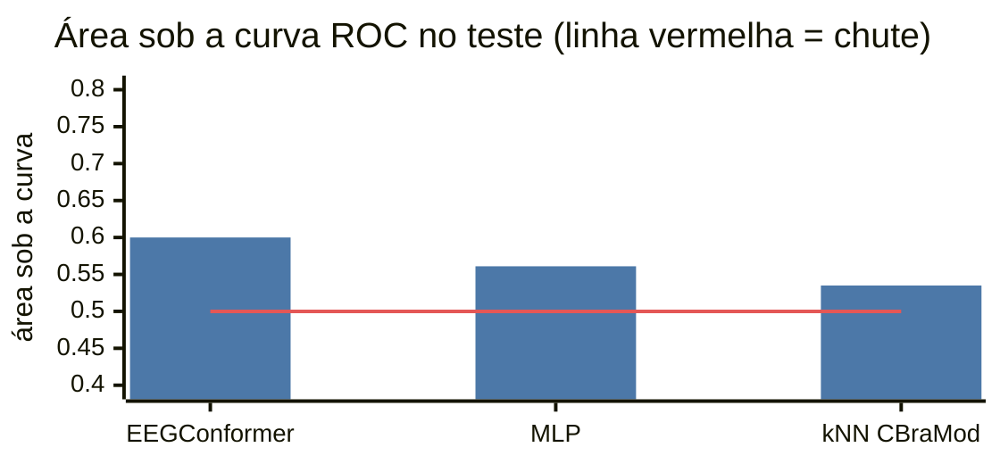

# Decodificação da intenção de movimento — BCI Competition IV 2a

Este projeto usa sinais de **eletroencefalograma (EEG)**, a atividade elétrica do cérebro medida
por eletrodos na cabeça, de 9 pessoas imaginando movimentos. O objetivo é descobrir se um
computador consegue perceber, só pelo sinal cerebral, que a pessoa **quer** se mexer.



**Palavras usadas em todo o texto:**

- **Tentativa:** cada vez que a pessoa vê uma seta na tela e imagina o movimento pedido (cerca de 4 segundos).
- **Sujeito ou paciente:** cada uma das 9 pessoas, chamadas de A01 a A09.
- **Treino, validação e teste:** o modelo aprende com o treino, é ajustado na validação e é
  avaliado uma única vez no teste, com pessoas que ele nunca viu.

## Como rodar

```powershell
uv sync --locked                                          # instala as bibliotecas (Python 3.12)
uv run python -m src.ingest                               # Tarefa 2: monta as tabelas
uv run dbt build --project-dir dbt --profiles-dir dbt     # Tarefa 3: roda os testes de qualidade
uv run python -m src.train                                # Tarefa 4: treina EEGConformer e MLP
uv run python -m src.embed                                # Tarefa 5: embeddings e vizinhos
uv run jupyter notebook notebooks/                        # abre os cadernos com os gráficos
```

Os resultados já estão salvos no repositório, então o caderno `02_modelo_2a` abre sem internet.
Os outros passos baixam os dados na primeira vez.

```
src/        código de cada etapa
data/       tabelas, predições e resultados
models/     modelos treinados
dbt/        testes de qualidade
notebooks/  01_dados_2a (Tarefas 1 a 3) e 02_modelo_2a (Tarefas 4 e 5)
```

---

## Tarefa 1 — Conhecer os dados

| item | resumo |
|---|---|
| Fonte | BCI Competition IV 2a, da Universidade de Tecnologia de Graz (Áustria) — [artigo de referência](https://doi.org/10.3389/fnins.2012.00055) |
| O que foi gravado | 22 eletrodos na cabeça + 3 eletrodos em volta dos olhos (para detectar piscadas), 250 medições por segundo |
| Movimentos imaginados | mão esquerda, mão direita, pés e língua |
| Tamanho | 9 pessoas × 2 dias × 288 tentativas = **5.184 tentativas** |
| Licença | permite usar, mas **proíbe redistribuir versões modificadas** — por isso o sinal não fica no repositório |
| Privacidade | as pessoas não são identificadas, mas o sinal cerebral é único de cada um, como uma impressão digital |

**Avaliação de boas práticas de dados abertos** (nota de 1 a 5):

| critério | nota | por quê |
|---|:---:|---|
| Fácil de encontrar | 5 | tem identificador permanente e aparece nas bibliotecas da área |
| Fácil de acessar | 5 | download livre, sem cadastro |
| Fácil de combinar com outros dados | 4 | formato aberto, mas fora do padrão mais recente da área |
| Fácil de reutilizar | 3 | a licença proíbe distribuir versões modificadas e quase não há dados das pessoas |

**Média: 4,25 de 5.**

**Limitações:** só 9 pessoas, todas saudáveis; só 2 dias de gravação; piscadas atrapalham o sinal;
não se sabe se cada pessoa é destra ou canhota.

> O material da Aula 01, com o conjunto de dados usado antes, está em [`archive_aula01/`](archive_aula01/).

---

## Tarefa 2 — Organizar em tabelas

As **informações sobre cada tentativa** (quem, quando, qual movimento), sem o sinal cerebral, foram
organizadas em 5 tabelas ligadas entre si. Uma tabela central guarda as tentativas, e as outras
descrevem a pessoa, o dia, o bloco de gravação e o movimento.



- **Cada linha da tabela central é uma tentativa** (5.184 no total).
- Informação que não existe na fonte (mão dominante) fica **vazia**, nunca com um valor inventado.
- Os nomes reais no código estão em inglês (`fact_trial`, `dim_subject`…), em [`src/ingest.py`](src/ingest.py).
- O formato **Parquet** (organizado por colunas) ficou **6 vezes menor** que uma planilha comum
  (CSV) e as consultas ficaram **20 vezes mais rápidas**.

---

## Tarefa 3 — Checar a qualidade

Os dados passam por 3 camadas, cada uma mais limpa que a anterior:



| verificação | resultado |
|---|---|
| Linhas repetidas | nenhuma |
| Campos preenchidos | 100% (menos a mão dominante, que não existe na fonte) |
| Regras de valores válidos (18 regras) | nenhum erro |
| Tentativas marcadas com ruído pelos autores | 488 de 5.184 (**9,4%**) — continuam na tabela, mas marcadas, e são deixadas de fora das análises |

**Correções feitas:** idade e sexo, que estavam vazios, passaram a ser lidos do arquivo original;
uma coluna de data que não existia na fonte foi removida.

**Para qualquer pessoa conseguir rodar igual:** as versões de todas as bibliotecas estão fixadas
em [`pyproject.toml`](pyproject.toml) e [`uv.lock`](uv.lock).

---

## Tarefa 4 — Aprendizado de máquina, redes neurais e avaliação

**Pergunta:** detecção da intenção de movimento. O modelo decide se uma janela de EEG é
**intenção** (imagética motora: a pessoa está imaginando o movimento) ou **repouso**, em
pacientes que ele nunca viu.

De cada tentativa saem 2 janelas de 1,5 segundo, então metade é de cada classe:

- **repouso:** a janela logo **antes** do cue (a seta que aparece na tela);
- **intenção:** a janela de 1,5 a 3 segundos **depois** do cue, quando a pessoa já está imaginando.

### O que escolhi entre as opções da aula

Etapas de treino (verde = usado, cinza = não usado):



| tema da aula | opções | **escolhi** | por quê |
|---|---|---|---|
| Etapas de treino | pré-treino, treino supervisionado, ajuste por preferência, inferência | **treino supervisionado + inferência** | os modelos são treinados do zero; o pré-treino aparece na Tarefa 5; ajuste por preferência é etapa de modelos de linguagem |
| Rede neural | escolha livre | **EEGConformer** comparado a um **MLP** | EEGConformer é feito para EEG e lê o sinal inteiro; o MLP (rede neural simples) serve de base de comparação |
| Pré-processamento | z-score, one-hot, min–max | **z-score**, ajustado só no treino | não há variável de categoria (one-hot não se aplica) e o z-score já põe tudo na mesma escala |
| Contra overfitting (o modelo decorar o treino) | regularização L2, dropout, parada antecipada | **os três** | dropout de 0,5; para na época de maior área sob a curva ROC na validação |
| Divisão dos dados | por amostra, por paciente | **por paciente** | treino A01–A05, validação A06–A07, teste A08–A09, avaliado uma única vez |
| Métricas | matriz de confusão, sensibilidade, especificidade, precisão, acurácia, área sob a curva ROC | **todas**, com intervalo de confiança de Wilson | mostram acerto em cada classe, e não só o geral |
| Testes estatísticos | McNemar, DeLong, qui-quadrado, correção de Holm, bootstrap por paciente | **McNemar, DeLong e qui-quadrado, com correção de Holm** | bootstrap por paciente não, porque o teste tem só 2 pacientes |

### Pipeline de dados e treino



- **EEGConformer** ([Song e colegas, 2023](https://doi.org/10.1109/TNSRE.2022.3230250)): convolução +
  Transformer, recebe o sinal bruto dos 22 canais.
- **MLP:** recebe só a potência das bandas **mu** (8–12 Hz) e **beta** (13–30 Hz) de cada canal.
  Esses ritmos **diminuem** quando a pessoa imagina um movimento.
- **Limiar:** valor da saída a partir do qual o modelo diz "intenção", escolhido na validação.

### Resultados

**Área sob a curva ROC:** vai de 0,5 (igual a chutar) a 1 (acerta sempre).



No teste (A08 e A09), com o limiar escolhido na validação:

| modelo | sensibilidade<br/>(acerta intenção) | especificidade<br/>(acerta repouso) | precisão | acurácia |
|---|---|---|---|---|
| **EEGConformer** | 78,0% | 37,2% | 55,4% | **57,6%** |
| MLP | 74,3% | 35,8% | 53,6% | 55,0% |

Testes estatísticos (a diferença é real quando o p corrigido por Holm fica abaixo de 0,05):

| pergunta | teste | p corrigido | resposta |
|---|---|---|---|
| Os dois modelos acertam amostras diferentes? | McNemar | 0,102 | não |
| O EEGConformer separa melhor as classes que o MLP? | DeLong | 0,018 | **sim** |
| O acerto muda de um paciente para outro (A08 61%, A09 54%)? | qui-quadrado | 0,002 | **sim** |
| O acerto muda com o membro imaginado? | qui-quadrado | 0,362 | não |
| O acerto muda com o artefato? | qui-quadrado | 0,362 | não |

**O que isso quer dizer:**

- O EEGConformer separa melhor que o MLP, mas os dois ficam pouco acima do chute nos pacientes novos.
- A área sob a curva ROC cai de 0,76 na validação para 0,60 no teste: **domain shift entre
  pessoas**, ou seja, cada cérebro tem um padrão diferente e o modelo perde desempenho em quem não conhece.
- O limiar da validação aumenta a sensibilidade e derruba a especificidade: o modelo responde
  "intenção" quase sempre.

**Limitações:** só 2 pacientes de teste; o repouso é a espera antes do cue, não um repouso livre;
a saída do modelo não é uma probabilidade calibrada; voluntários saudáveis em laboratório.

---

## Tarefa 5 — Embeddings, CLIP, VLM

**Ideia:** usar um **modelo de fundação** de EEG (já pré-treinado por outros pesquisadores), sem
treinar de novo, para transformar cada janela em um **embedding**: uma lista de números que resume
o sinal. Janelas com embeddings parecidos são **vizinhos**.

### O que escolhi entre as opções da aula



| tema da aula | opções | **escolhi** | por quê |
|---|---|---|---|
| Abordagem | embeddings + busca de vizinhos, CLIP, VLM | **embeddings + busca de vizinhos** | é a única que funciona direto no EEG; CLIP e VLM exigem imagem ou texto |
| Codificador de EEG | BIOT (citado na aula), CBraMod | **CBraMod** | pré-treinado em um único conjunto de EEG de hospital, de origem conhecida e **sem os dados deste projeto**; pesos públicos no Hugging Face, carregados pelo `braindecode` já usado |
| Uso do modelo | congelado, ajuste fino | **congelado** | testa o que o modelo já sabe, sem nenhum rótulo deste projeto |
| Busca | busca exata, índice aproximado (HNSW, FAISS), banco vetorial (pgvector, Qdrant) | **busca exata**, em Parquet + DuckDB | com ~10 mil vetores ela leva segundos e não perde vizinhos; índice e banco vetorial só compensam com milhões |
| Auditoria de quase duplicatas | vizinho → ordenar → inspecionar → corrigir | **os 4 passos** | confere se há cópias entre treino e teste |

### Pipeline



- **Modelo:** [CBraMod](https://arxiv.org/abs/2412.07236) (2025), pesos
  [`braindecode/cbramod-pretrained`](https://huggingface.co/braindecode/cbramod-pretrained).
- **Cosseno:** medida de semelhança entre dois embeddings (1 = idênticos).
- **Saídas:** `fact_embedding.parquet`, `fact_neighbor.parquet` e `pares_vizinhos.png`, em `data/embeddings/`.

### Resultados

| verificação | resultado |
|---|---|
| Quase duplicatas entre treino e teste (cosseno > 0,99) | **nenhuma** (maior: 0,55) |
| Cópias exatas do sinal (hash) | **nenhuma** |
| Vizinhos do mesmo paciente (por acaso seria 11%) | **25,4%** |
| Vizinhos da mesma janela (por acaso seria 50%) | 52,3% |
| kNN intenção × repouso, área sob a curva ROC no teste | 0,535 |

O embedding **junta janelas do mesmo paciente**, e não da mesma tarefa:



E não separa intenção de repouso — o kNN fica abaixo dos dois modelos da Tarefa 4:



Na figura, a linha azul é uma janela de teste e a laranja tracejada é o seu vizinho mais parecido
no treino, nos canais C3, Cz e C4 (lado esquerdo, centro e lado direito da cabeça). As 3 fileiras vão
do par mais parecido ao menos parecido. Na primeira fileira, o vizinho mais parecido de um
**repouso** é uma **intenção**.


**O que isso quer dizer:**

- ✔ **Sem quase duplicatas** entre treino e teste, então os resultados da Tarefa 4 não foram inflados.
- ✔ O embedding reconhece **de quem é o sinal**: é o **EEG fingerprinting** (impressão digital
  cerebral) citado na Tarefa 1, e ajuda a explicar o domain shift da Tarefa 4.
- ✘ Não percebe a intenção de movimento: o pré-treino não tinha rótulo de tarefa e o modelo foi
  usado congelado, sem ajuste fino.

**Limitações:** só 2 pacientes de teste; k = 10 vizinhos, fixo; janelas de 1 segundo; os eletrodos e
o aparelho são diferentes dos usados no pré-treino.
