# Decodificação da intenção de movimento — BCI Competition IV 2a

Sinal cerebral (eletroencefalograma) de 9 pessoas imaginando movimentos. Objetivo: detectar, só
pelo sinal, que a pessoa **quer** se mexer.

| etapa | o que faz | seção |
|---|---|---|
| Tarefa 1 | conhecer os dados | [ficha técnica](#tarefa-1--conhecer-os-dados) |
| Tarefa 2 | organizar em tabelas | [esquema estrela](#tarefa-2--organizar-em-tabelas) |
| Tarefa 3 | checar a qualidade | [testes](#tarefa-3--checar-a-qualidade) |
| Tarefa 4 | modelos e avaliação | [modelos](#tarefa-4--modelos-e-avaliação) |
| Tarefa 5 | embeddings | [vizinhos](#tarefa-5--embeddings) |
| Tarefa 6 | pipeline automático e registrado | [mapa do pipeline](#tarefa-6--mapa-do-pipeline) |
| | o que não se pode concluir | [LIMITACOES.md](LIMITACOES.md) |

## Como reproduzir

```powershell
git clone https://github.com/kafb04/data-engineering-multimodal-ai.git
cd data-engineering-multimodal-ai
uv sync --locked                    # instala o Python 3.12 e as bibliotecas nas versões travadas
uv run python run_pipeline.py       # roda tudo, do download dos dados às figuras
```

| requisito | detalhe |
|---|---|
| Sistema | Windows, Linux ou macOS. Só precisa do [uv](https://docs.astral.sh/uv/); sem Docker |
| Hardware | só CPU (sem placa de vídeo) |
| Internet | na primeira execução: ~750 MB de sinal (MOABB, em `~/mne_data`) e os pesos do CBraMod (Hugging Face) |
| Tempo | cerca de 1 h em um computador comum (o treino leva de 47 a 54 min), mais o download na primeira vez |

**Sem rodar nada**, os resultados já estão no repositório: modelos treinados (`models/`), predições
e tabelas (`data/`), números ([`outputs/metricas.json`](outputs/metricas.json)), figuras
(`figuras/`) e o registro da execução que os produziu (`outputs/execucoes/`).

---

## Tarefa 1 — Conhecer os dados

> **Pergunta:** este conjunto de dados serve para estudar a intenção de movimento? O que ele tem,
> e com quais limites?

### Ficha técnica

| item | resumo |
|---|---|
| Nome | BCI Competition IV 2a (`BNCI2014_001` no [MOABB](https://moabb.neurotechx.com/)) |
| Fonte | Universidade de Tecnologia de Graz. Tangermann et al. (2012), [DOI 10.3389/fnins.2012.00055](https://doi.org/10.3389/fnins.2012.00055) |
| Licença | **CC BY-ND 4.0**: pode usar e citar, mas não distribuir versão modificada. Por isso o sinal **não fica no repositório**: o MOABB baixa na primeira execução |
| Tamanho | 9 pessoas × 2 dias × 288 tentativas = **5.184 tentativas**, 12 por classe em cada bloco (equilibradas) |
| Privacidade | anônimo (A01–A09, só idade e sexo). Risco que sobra: o sinal cerebral funciona como impressão digital, mas reconhecer alguém exigiria outra gravação da mesma pessoa |
| Aplicação | interface cérebro-computador para reabilitação e comunicação de pessoas com AVC, ELA ou lesão medular |

### Variáveis

| variável | formato | valores |
|---|---|---|
| Sinal cerebral (EEG) | 22 eletrodos, em volts | ±100 µV, **250 medições por segundo**, filtrado entre 0,5 e 100 Hz |
| Movimento dos olhos (EOG) | 3 eletrodos | usado para identificar piscadas |
| Classe | rótulo da tentativa | mão esquerda, mão direita, pés, língua |
| Dia | 2 por pessoa | treino e avaliação, em dias diferentes |
| Pessoa | identificador | A01 a A09 |

### Uma tentativa

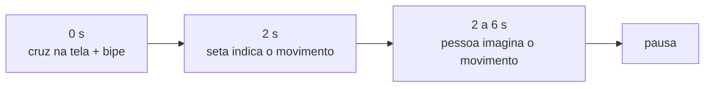

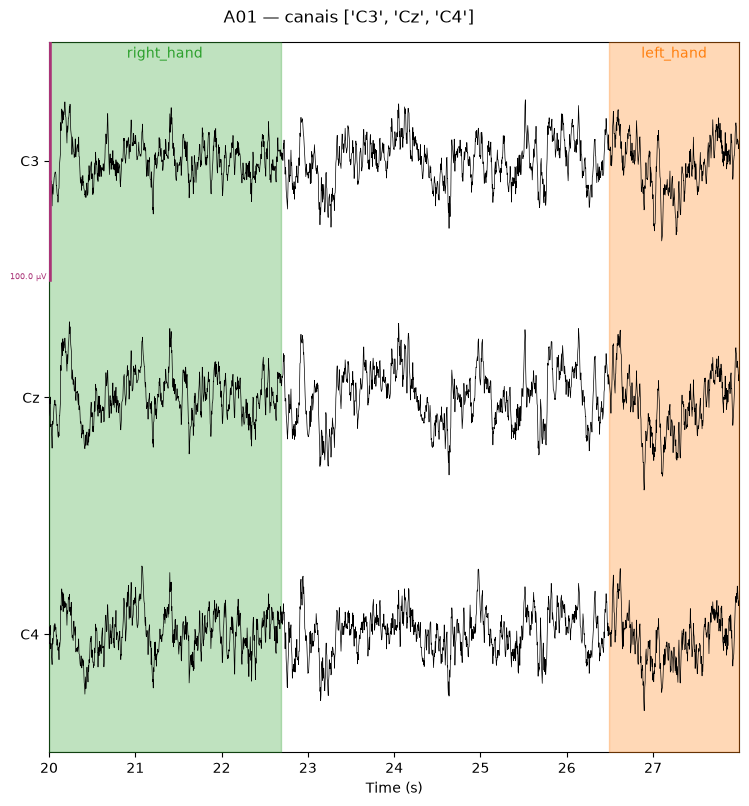
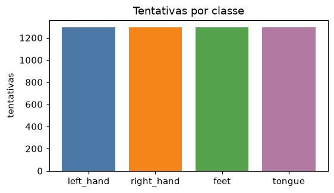

À esquerda, o sinal dos eletrodos C3, Cz e C4 (lado esquerdo, centro e lado direito da cabeça, sobre
a área do movimento). À direita, as 4 classes, equilibradas.

### Uso em aprendizado de máquina

| item | resumo |
|---|---|
| **Entrada** | 22 eletrodos × 4 s (1.000 medições), com foco em C3, Cz e C4 e nos ritmos mu (8–12 Hz) e beta (13–30 Hz) |
| **Alvo** | qual movimento a pessoa imagina |
| **Métodos conhecidos** | CSP + LDA, classificadores de Riemann e redes neurais (EEGNet, ShallowConvNet), todos no [braindecode](https://braindecode.org/) |

### Dados abertos (FAIR)

| critério | nota | por quê |
|---|:---:|---|
| Fácil de encontrar | 5 | DOI e identificador fixo no BNCI Horizon e no MOABB |
| Fácil de acessar | 5 | download aberto, sem cadastro; uma linha de código no MOABB |
| Fácil de combinar | 4 | formato aberto (GDF), mas fora do padrão BIDS e sem posição dos eletrodos |
| Fácil de reutilizar | 3 | origem bem documentada, mas a licença proíbe versões modificadas e falta a mão dominante |
| **Média** | **4,25** | |

### Limitações

- **Só 9 pessoas**, todas saudáveis: pouco para generalizar entre pessoas e nada sobre pacientes.
- **Só 2 dias** por pessoa: pouco para estudar a estabilidade ao longo do tempo.
- **Piscadas atrapalham** o sinal: 9,4% das tentativas vêm marcadas com ruído.
- **Faltam dados da pessoa**: não há mão dominante, que muda a assimetria esperada entre os lados.
- **Laboratório controlado**, com tentativas curtas: tende a superestimar o acerto no uso real.

---

## Tarefa 2 — Organizar em tabelas

> **Objetivo:** guardar as informações de cada tentativa (sem o sinal) em tabelas fáceis de consultar.

### Esquema estrela

Uma tabela central (**fato**) com uma linha por tentativa, ligada a 4 tabelas de descrição
(**dimensões**). Gerado por [`src/ingest.py`](src/ingest.py), uma pessoa por vez.

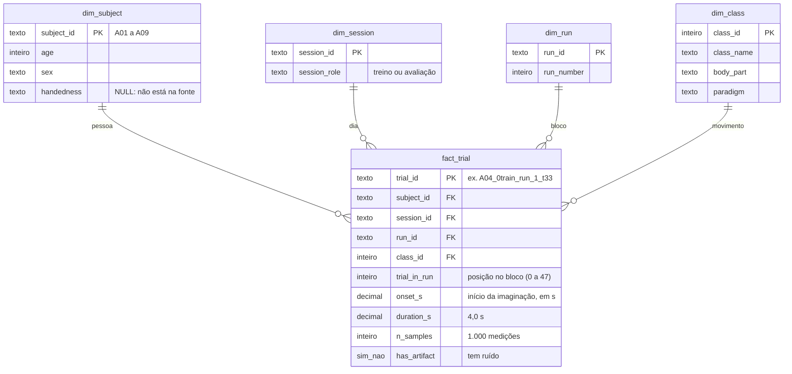

**Grão:** 1 linha da fato = 1 tentativa (5.184 linhas).

### Decisões

| decisão | por quê |
|---|---|
| Estrela, com cada dimensão em uma tabela só | as dimensões são pequenas (2 a 9 linhas): um join por dimensão basta |
| Chaves em texto (`A01`, `0train`, `run_0`) | a fonte é fechada e as chaves são estáveis e legíveis |
| Dado ausente fica `NULL` | a mão dominante não está na fonte; nada de valor falso como `-1` |
| Sinal fora do Parquet | só metadados e rótulos entram; o sinal fica no cache do MOABB (licença) |

### Resultado: CSV × Parquet

| mesma tabela fato | CSV | Parquet |
|---|---|---|
| Tamanho | 329,8 KiB | **54,1 KiB** (6× menor) |
| Tipos das colunas | perdidos (tudo vira texto) | guardados (inteiro, decimal, sim/não) |

---

## Tarefa 3 — Checar a qualidade

> **Pergunta:** as tabelas estão corretas e completas? O que fazer com o que está errado?

### Camadas


Os testes rodam no [dbt](https://www.getdbt.com/) sobre o DuckDB, em dois arquivos:

| arquivo | o que confere |
|---|---|
| [`dbt/models/schema.yml`](dbt/models/schema.yml) | chaves únicas e não nulas, ligações entre tabelas, valores permitidos (21 testes nas tabelas de entrada, 2 no Ouro e 15 nas predições da Tarefa 4) |
| [`dbt/tests/regras_de_dominio.sql`](dbt/tests/regras_de_dominio.sql) | 11 regras do desenho do experimento: 48 tentativas por bloco e 12 por classe, 4 s e 1.000 medições por tentativa, 7,5 a 8,5 s entre tentativas, `trial_id` composto das chaves, idade plausível... |

Se uma regra falhar, a etapa `qualidade` falha e o treino não roda (Tarefa 6).

### Resultado

| verificação | resultado |
|---|---|
| Linhas repetidas | **nenhuma** (chaves únicas) |
| Campos preenchidos | **100%**, exceto mão dominante (0%) |
| Valores inválidos (11 regras) | **nenhum** |
| Tentativas com ruído | 488 de 5.184 (**9,4%**) |

### Problemas encontrados e decisões

| problema | decisão |
|---|---|
| Idade e sexo vinham vazios, mas estão na fonte | **corrigido**: a ingestão passou a ler os dois |
| A marcação de ruído era descartada | **quarentena**: as 488 tentativas ficam na Prata marcadas (`has_artifact`) e o Ouro separa as válidas |
| `onset_s` era descrito como início da tentativa | **corrigido**: é o início da imaginação (2 s depois) |
| Mão dominante 0% preenchida | **mantido** como `NULL`: não está na fonte |
| Coluna de data vazia e na tabela errada | **removida**: a fonte não traz a data |

### Limitações

- **A quarentena é desigual:** A06 perde 24,7% das tentativas; A01, só 3,8%. Sem elas, as classes
  deixam de ser equilibradas.
- **A marcação de ruído é dos autores** do conjunto e não foi refeita aqui.
- **As regras olham os metadados, não o sinal:** um eletrodo ruidoso não aparece.

---

## Tarefa 4 — Modelos e avaliação

> **Pergunta:** só pelo sinal, um modelo sabe se a pessoa está em **repouso** ou com **intenção** de
> se mexer, mesmo em pessoas que ele **nunca viu**?

### Como

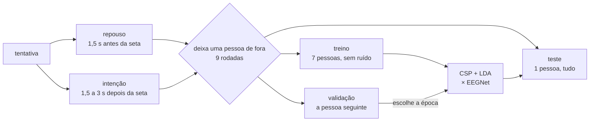

Em cada rodada, uma pessoa fica de fora para o teste, a seguinte na lista valida (A01 testa e A02
valida; A09 testa e A01 valida) e as outras 7 treinam. Assim **as 9 pessoas são testadas** por
modelos que nunca viram o seu sinal. Gerado por [`src/train.py`](src/train.py).

| | CSP + LDA | EEGNet |
|---|---|---|
| **Ideia** | 6 filtros espaciais que mais separam as classes pela potência do sinal (CSP) + regra linear (LDA) | rede convolucional compacta, feita para EEG |
| **Entrada** | 22 eletrodos, filtro 4–38 Hz, 128 medições por segundo | o mesmo sinal, com z-score |
| **Treino** | ajuste direto | 40 épocas; guarda a época de maior área ROC na validação |
| **Papel** | referência clássica de interfaces cérebro-computador | rede pequena, treina em CPU (9 rodadas em menos de 1 h) |

| cuidado | como |
|---|---|
| Não vazar o teste | z-score e CSP calculados só com as 7 pessoas de treino; a pessoa de teste não entra no treino nem na escolha da época |
| Não decorar o treino | penalização dos pesos e escolha da época em **outra** pessoa (a de validação) |
| Unidade de avaliação | **a pessoa**: cada métrica é calculada por pessoa de teste e resumida entre as 9 |
| Comparar com rigor | **Wilcoxon** pareado entre as 9 pessoas, com correção de **Holm** para os 6 testes |

### Resultado 1 — A validação estabiliza cedo

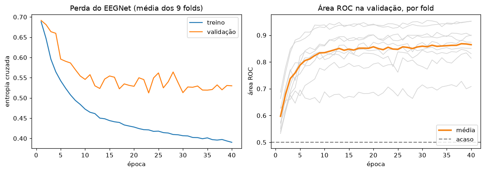

O erro no treino (azul) cai sempre; o da validação (laranja) para de cair perto da época 15. A área
ROC na validação (direita, uma linha cinza por rodada) também estabiliza, perto de 0,86. **A época
guardada é a melhor de cada rodada na validação** (entre a 20ª e a 40ª).

### Resultado 2 — O EEGNet detecta a intenção em todas as pessoas

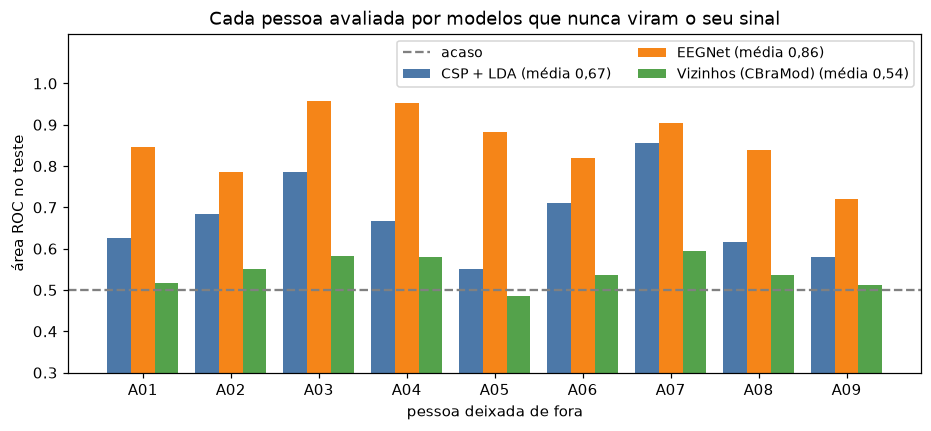

| média entre as 9 pessoas | área ROC (mín.–máx.) | acurácia | intenções detectadas | repousos detectados |
|---|---|---|---|---|
| **EEGNet** | **0,86** (0,72–0,96) | **76,8%** | 84,2% | 69,4% |
| CSP + LDA | 0,67 (0,55–0,86) | 60,1% | 60,7% | 59,4% |
| Vizinhos do CBraMod ([Tarefa 5](#tarefa-5--embeddings)) | 0,54 (0,48–0,59) | 53,1% | 65,9% | 40,4% |

- **Os três ficam acima do acaso** (área 0,50): EEGNet e CSP + LDA nas 9 pessoas, os vizinhos em 8
  (Wilcoxon, p ≤ 0,016 corrigido por Holm).
- **O EEGNet supera o CSP + LDA nas 9 pessoas** (p = 0,016 corrigido), e o CSP + LDA supera os
  vizinhos nas 9.
- **A validação prevê o teste:** área média de 0,87 na pessoa de validação e 0,86 na de teste.

### Resultado 3 — O EEGNet erra mais os repousos

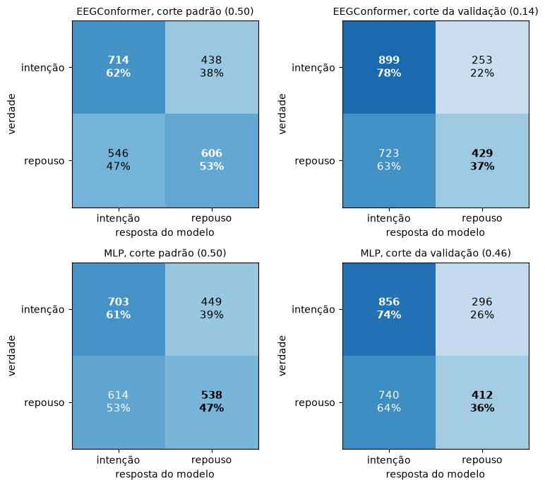

Cada linha separa os trechos de uma classe pelo que o modelo respondeu (corte 0,5); os acertos
estão na diagonal.

- **EEGNet:** 31% dos repousos viram "intenção", contra 16% das intenções que viram "repouso".
- **CSP + LDA:** o corte 0,5 não vale para todas as pessoas. Em uma, o modelo responde "intenção"
  em quase tudo (só 3% dos repousos certos); em outra, acha só 23% das intenções.
- **Nem o movimento nem o ruído pesam:** o EEGNet detecta de 82% a 86% das intenções de cada
  movimento imaginado e acerta 77,0% dos trechos sem ruído e 75,5% dos com ruído.

### Resposta

**Sim, com ressalvas.** O EEGNet separa repouso de intenção em pessoas que nunca viu (área 0,86 em
média), e a pior pessoa ainda fica em 0,72. Mas a variação entre pessoas é grande (0,72 a 0,96), e o
que o modelo aprendeu é "antes × depois da seta": parte disso pode ser resposta visual ou de
atenção, não intenção motora (ver [LIMITACOES.md](LIMITACOES.md)).

**Mudança desde as Aulas 04 e 05:** antes havia uma única divisão (treino A01–A05, teste A08–A09) e
o EEGConformer chegava a 0,60. Nas mesmas duas pessoas, o EEGNet chega a 0,84 (A08) e 0,72 (A09).
Mudaram o modelo, o pré-processamento e o número de pessoas no treino (7 em vez de 5).

---

## Tarefa 5 — Embeddings

> **Pergunta:** um modelo pré-treinado em muitos sinais cerebrais (**CBraMod**) ajuda a entender a
> Tarefa 4? Há **cópias** entre treino e teste? Ele separa **repouso** de **intenção**?

### Como

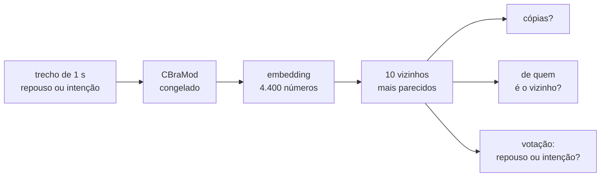

- **Embedding:** lista de números que resume o trecho. Trechos parecidos têm embeddings próximos (**vizinhos**).
- **Congelado:** os pesos não mudam, então mede só o que o modelo já sabia do pré-treino, feito sem estes dados.
- **Duas buscas exatas por cosseno** ([`src/embed.py`](src/embed.py)): cada trecho contra **todos** os
  outros (cópias e peso da pessoa) e cada trecho da pessoa de teste contra os trechos sem ruído das
  **7 pessoas de treino da mesma rodada** da Tarefa 4 (votação).

### Resultado 1 — Nenhuma cópia

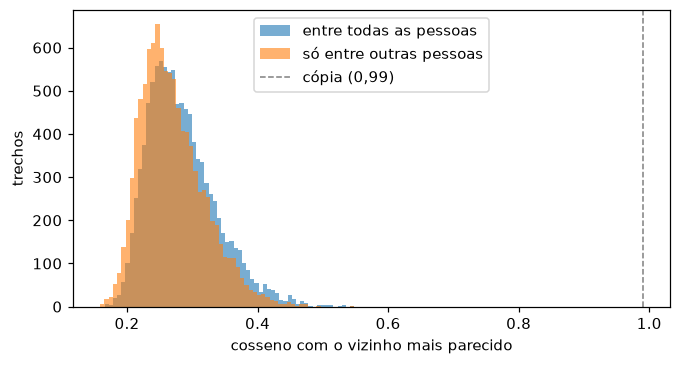

Semelhança (cosseno) de cada trecho com o vizinho mais parecido de outra tentativa. O maior valor é
**0,55**; cópia seria perto de **0,99** (linha tracejada). Nenhum par passa de 0,99 e nenhum sinal se
repete (mesmo hash).


Inspeção dos pares de maior, mediana e menor semelhança entre pessoas diferentes (espectro em C3, Cz
e C4). Mesmo o par mais parecido (1ª fileira) junta pessoas e classes diferentes: um repouso de A08 e
uma intenção de A02.

### Resultado 2 — O modelo agrupa por pessoa, não por intenção


Embeddings projetados em 2 dimensões (t-SNE). À esquerda, cor = pessoa: A09 (azul-claro) forma um
grupo próprio. À direita, cor = trecho: repouso e intenção se misturam.

| o vizinho é... | acaso | obtido |
|---|---|---|
| da **mesma pessoa** | 11,1% | **25,4%** (de 12,5% em A07 a 47,6% em A09) |
| da **mesma classe** | 50% | 52,3% |

### Resultado 3 — Votar pelos vizinhos fica perto do acaso

Cada trecho de teste recebe a fração dos seus 10 vizinhos que são "intenção". Área ROC média de
**0,54** (0,48 a 0,59), abaixo do CSP + LDA e do EEGNet em todas as pessoas
([Resultado 2 da Tarefa 4](#resultado-2--o-eegnet-detecta-a-intenção-em-todas-as-pessoas)).

### Resposta

- **Sem cópias:** os resultados da Tarefa 4 não foram inflados por trechos repetidos.
- **O modelo reconhece de quem é o sinal** (impressão digital cerebral): um em cada quatro vizinhos é
  da mesma pessoa. É o mesmo efeito que faz a área da Tarefa 4 variar tanto entre pessoas.
- **Não reconhece a intenção:** foi pré-treinado sem saber o que a pessoa fazia e usado congelado.

---

## Tarefa 6 — Mapa do pipeline

> **Objetivo:** o projeto roda sozinho, do dado bruto às figuras, e registra o que fez.

### DAG

Cada caixa é uma etapa; a seta significa "depende de". Cilindros são fontes externas.

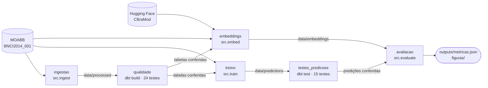

| etapa | comando | entradas | saídas | depende de |
|---|---|---|---|---|
| `ingestao` | `python -m src.ingest` | sinal (MOABB) | `data/processed/` (5 tabelas) | — |
| `qualidade` | `dbt build --exclude source:predictions` | `data/processed/` | `data/gold/`; 24 testes | `ingestao` |
| `treino` | `python -m src.train` | sinal, `fact_trial` | `models/eegnet_*.pt`, `data/predictions/` | `qualidade` |
| `testes_predicoes` | `dbt test --select source:predictions` | `data/predictions/`, `fact_trial` | 15 testes | `treino` |
| `embeddings` | `python -m src.embed` | sinal, `fact_trial`, pesos do CBraMod | `data/embeddings/`, `figuras/pares_vizinhos.png` | `qualidade` |
| `avaliacao` | `python -m src.evaluate` | tabelas das camadas Prata e Ouro, predições, vizinhos | `outputs/metricas.json`, 7 figuras | `testes_predicoes`, `embeddings` |

Os 39 testes do dbt rodam em dois momentos: os das tabelas de entrada **antes** de treinar (dado
ruim não chega ao modelo) e os da tabela de predições **depois**, porque ela só existe após o treino.

### Orquestração

Um script só com a biblioteca padrão do Python ([`run_pipeline.py`](run_pipeline.py)) faz o papel
do orquestrador: **coordena** (ordem e falhas) e **registra** (o que rodou, com quê e o que saiu).

```powershell
uv run python run_pipeline.py                        # tudo, na ordem do DAG
uv run python run_pipeline.py embeddings avaliacao   # refaz só as etapas nomeadas
```

| função | como |
|---|---|
| Ordem | o DAG é declarado em um dicionário; a ordem sai da ordenação topológica (`graphlib`) |
| Falha | a etapa fica `falhou` se sair com erro **ou** não gravar saída nova; as que dependem dela ficam `nao_rodou`; as outras seguem |
| Reprocessar | basta nomear as etapas; o resto vale o que já está no disco |
| Registro | um JSON por etapa em `outputs/execucoes/`, com `sha256` de cada entrada e saída |

**Por que não Airflow ou Dagster:** são 6 etapas em lote, rodadas uma vez, em uma máquina. Agenda,
retentativas e painel não seriam usados, e o Airflow exigiria Linux ou Docker.

### Testes do código

```powershell
uv run python -m unittest -v
```

13 testes ([`tests/test_projeto.py`](tests/test_projeto.py)) do que não depende do sinal: a divisão
(cada pessoa testada uma vez, sem sobreposição), a correção de Holm, a montagem da tabela fato e a
marcação de ruído, e o orquestrador (falha bloqueia só as dependentes, saída ausente ou antiga conta
como falha, DAG válido). Rodam em 2 s.

### Registro de uma execução completa

Execução do zero em 25/11/2026 (Windows 11, Python 3.12.13, só CPU), com as pastas `data/`,
`models/`, `figuras/` e `outputs/` apagadas antes (o sinal e os pesos do CBraMod já estavam no
cache). Fica em [`outputs/execucoes/`](outputs/execucoes/):

| etapa | status | início | duração |
|---|---|---|---|
| `ingestao` | ok | 15:56:18 | 1 min 02 s |
| `qualidade` | ok | 15:57:21 | 11 s |
| `treino` | ok | 15:57:32 | 54 min 15 s |
| `embeddings` | ok | 16:51:48 | 3 min 11 s |
| `testes_predicoes` | ok | 16:54:59 | 25 s |
| `avaliacao` | ok | 16:55:24 | 15 s |

**Reproduziu a execução anterior do zero (no mesmo dia):** as 27 áreas ROC (3 modelos × 9 pessoas),
as épocas escolhidas e as métricas dos embeddings são iguais.

**Teste de falha:** coberto pelos testes do código (`test_falha_bloqueia_so_as_dependentes`): com
uma etapa saindo com erro, ela fica `falhou`, a que depende dela fica `nao_rodou` (motivo:
`depende de ['b']`) e a independente roda.

Cada registro guarda também o comando, a semente, o commit do código, a versão do Python e o
sistema. Consultam-se como qualquer tabela:

```sql
SELECT etapa, status, duracao_s, commit
FROM read_json_auto('outputs/execucoes/*.json') ORDER BY inicio;
```

### Versões

| item | versão |
|---|---|
| Dados | BCI Competition IV 2a, `BNCI2014_001` pelo `moabb==1.7.2` |
| Bibliotecas | fixadas em [`pyproject.toml`](pyproject.toml) e travadas em [`uv.lock`](uv.lock); Python 3.12 |
| Modelos treinados | EEGNet do `braindecode==1.8.1` e CSP + LDA do `mne` e `scikit-learn`, semente 42; a versão vai em cada linha de `fact_prediction` (`model_version`) |
| Modelo pré-treinado | `braindecode/cbramod-pretrained` no commit `584cdc4` do Hugging Face |

### Limitações

- **Sem modo de amostra:** não há execução rápida com poucas pessoas; o treino leva cerca de 50 min em CPU.
- **Etapas em sequência:** `treino` e `embeddings` poderiam rodar em paralelo; o ganho seria de ~3 min.
- **Reprodução exata só no mesmo ambiente:** ver [LIMITACOES.md](LIMITACOES.md).
