# Decodificação da intenção de movimento — BCI Competition IV 2a

Sinal cerebral (eletroencefalograma) de 9 pessoas imaginando movimentos. Objetivo: detectar, só
pelo sinal, que a pessoa **quer** se mexer.

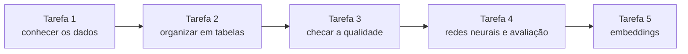

## Como rodar

```powershell
uv sync --locked                                          # instala as bibliotecas
uv run python -m src.ingest                               # Tarefa 2
uv run dbt build --project-dir dbt --profiles-dir dbt     # Tarefa 3
uv run python -m src.train                                # Tarefa 4
uv run python -m src.embed                                # Tarefa 5
uv run jupyter notebook notebooks/                        # gráficos e análises
```

---

## Tarefa 1 — Conhecer os dados

| item | resumo |
|---|---|
| Fonte | Universidade de Tecnologia de Graz — [artigo](https://doi.org/10.3389/fnins.2012.00055) |
| Gravação | 22 eletrodos na cabeça + 3 em volta dos olhos, 250 medições por segundo |
| Movimentos imaginados | mão esquerda, mão direita, pés, língua |
| Tamanho | 9 pessoas × 2 dias × 288 tentativas = **5.184 tentativas** |
| Licença | proíbe redistribuir versões modificadas, por isso o sinal não fica no repositório |

**Dados abertos (nota de 1 a 5):** fácil de encontrar 5 · fácil de acessar 5 · fácil de combinar 4 ·
fácil de reutilizar 3 → **média 4,25**.

Sinal dos eletrodos C3, Cz e C4 (lado esquerdo, centro e lado direito da cabeça) em duas tentativas,
e as 4 classes, equilibradas:

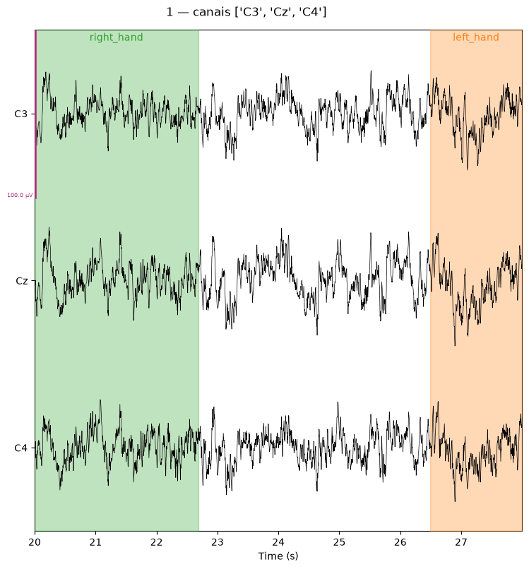
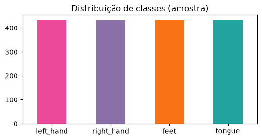

**Limitações:** só 9 pessoas saudáveis, 2 dias de gravação, piscadas atrapalham o sinal.

---

## Tarefa 2 — Organizar em tabelas

As informações de cada tentativa (sem o sinal) ficam em uma tabela central ligada a 4 tabelas de descrição.

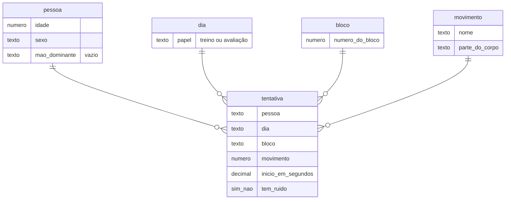

O formato Parquet ficou **6 vezes menor** que a planilha comum e as consultas, **20 vezes mais rápidas**.

---

## Tarefa 3 — Checar a qualidade


| verificação | resultado |
|---|---|
| Linhas repetidas | nenhuma |
| Valores inválidos (18 regras) | nenhum |
| Tentativas com ruído | 488 de 5.184 (**9,4%**), marcadas e deixadas de fora |

---

## Tarefa 4 — Redes neurais e avaliação

**Pergunta:** o modelo diz se a pessoa está em **repouso** ou com **intenção** de movimento, em
pessoas que ele nunca viu? Cada tentativa dá 2 trechos de 1,5 segundo do sinal: um logo antes da seta
na tela (repouso) e um de 1,5 a 3 segundos depois dela (intenção).

### Escolhas

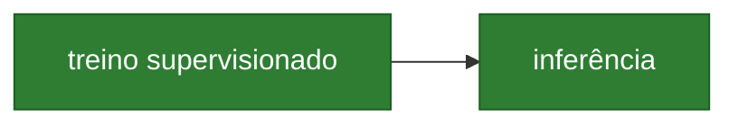

| tema | **escolhi** | por quê |
|---|---|---|
| Etapas de treino | **treino supervisionado + inferência** | os modelos são treinados do zero, direto com os rótulos de repouso e intenção, e depois usados para prever |
| Rede neural | **EEGConformer** × **perceptron multicamadas (MLP)** | o primeiro lê o sinal inteiro (convolução + atenção); o segundo, só a força dos ritmos cerebrais. Mostra se ler o sinal completo ajuda |
| Pré-processamento | **z-score**, só com o treino | deixa cada variável com média 0 e desvio 1; usar só o treino evita vazar informação do teste |
| Contra overfitting | **dropout, penalização dos pesos e parada antecipada** | desliga neurônios ao acaso, impede pesos grandes e para quando a validação não melhora: evita que o modelo decore o treino |
| Divisão | **por pessoa**: treino A01–A05, validação A06–A07, teste A08–A09 | testar em quem o modelo nunca viu |
| Testes estatísticos | **McNemar, DeLong e qui-quadrado, com correção de Holm** | McNemar compara os acertos dos dois modelos; DeLong, as áreas sob a curva ROC; qui-quadrado, o acerto entre grupos; Holm corrige por fazer vários testes |

### Resultados

**Overfitting:** a perda no treino cai sem parar, mas a da validação não acompanha. O modelo
guardado é o da época com maior área sob a curva ROC na validação (linha tracejada).

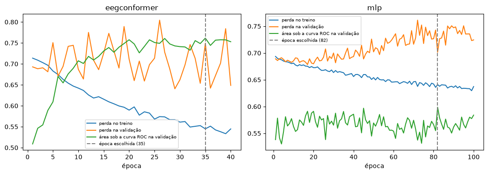

**Curva ROC no teste:** mostra sensibilidade × erros no repouso em todos os limiares. Quanto mais
acima da linha tracejada (acaso), melhor. O ponto marca o limiar escolhido na validação.

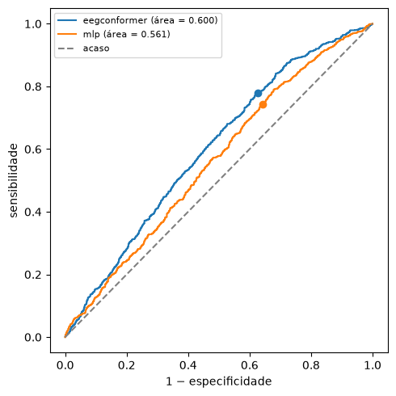

**Área sob a curva ROC:** 0,5 = chute, 1 = acerta sempre.

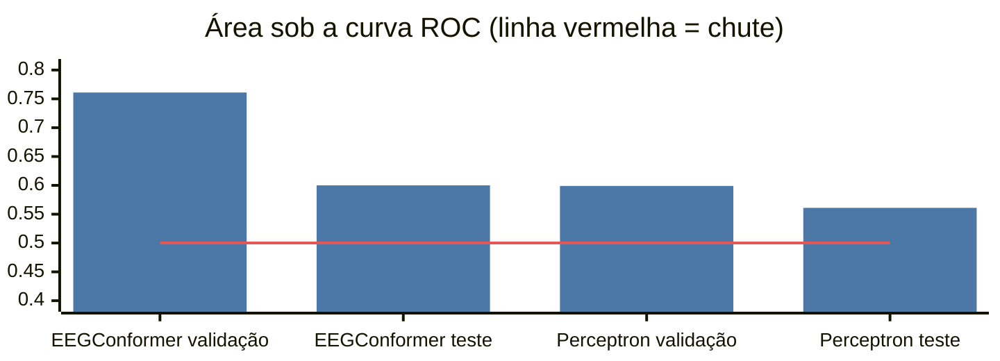

| no teste | sensibilidade | especificidade | acurácia |
|---|---|---|---|
| **EEGConformer** | 78,0% | 37,2% | **57,6%** |
| Perceptron multicamadas | 74,3% | 35,8% | 55,0% |

Os dois acertam a maioria das intenções e erram a maioria dos repousos: tendem a responder "intenção".

**Matriz de confusão no teste** (linha = verdade, coluna = resposta do modelo). Com o limiar da
validação, os dois modelos respondem "intenção" na maioria dos repousos. O limiar que servia para as
pessoas da validação não serve para as do teste:

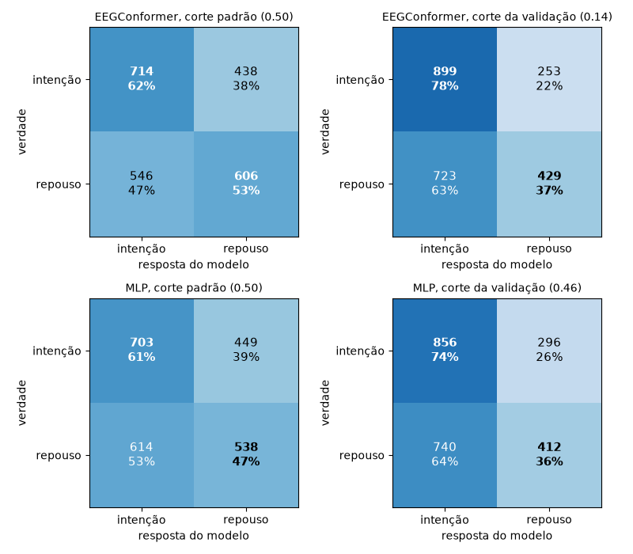

- O EEGConformer separa melhor as classes (DeLong, p = 0,018), mas os dois ficam pouco acima do chute.
- A nota cai de 0,76 na validação para 0,60 no teste: **cada cérebro é diferente** (domain shift).
- O acerto muda entre as pessoas de teste (61% × 54%, p = 0,002), mas não com o movimento nem com o ruído: o que pesa é a pessoa.

---

## Tarefa 5 — Embeddings, CLIP e modelos de visão e linguagem

**Ideia:** um modelo já pré-treinado transforma cada trecho em um **embedding** (4.400 números que
o resumem). Trechos com embeddings parecidos são **vizinhos**.

### Escolhas

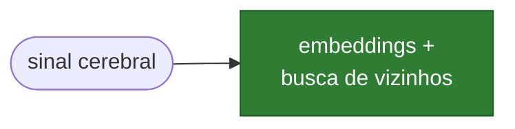

| tema | **escolhi** | por quê |
|---|---|---|
| Abordagem | **embeddings + busca de vizinhos** | funciona direto no sinal elétrico do cérebro |
| Modelo | **CBraMod** | pré-treinado sem os dados deste projeto (não viu o teste), pesos públicos |
| Uso do modelo | **congelado** | os pesos não mudam: testa só o que ele já sabe do pré-treino |
| Busca | **exata** | compara todos os trechos entre si; 10 mil trechos cabem em segundos |
| Quase duplicatas | **os 4 passos**: vizinho, ordenar, inspecionar, corrigir | procurar cópias entre treino e teste |

### Resultados

| verificação | resultado |
|---|---|
| Cópias entre treino e teste | **nenhuma** |
| Vizinhos da mesma pessoa (acaso: 11%, 1 em 9 pessoas) | **25,4%** |
| Vizinhos do mesmo tipo de trecho (acaso: 50%) | 52,3% |

Semelhança de cada trecho de teste com o vizinho mais parecido: nenhum chega perto de 0,99
(linha tracejada), o limite para ser considerado cópia.

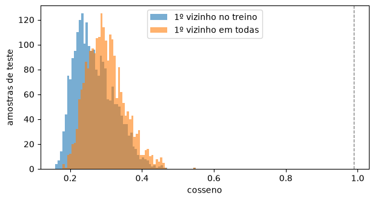

O modelo **agrupa por pessoa**, não por intenção:


O mapa t-SNE (embeddings projetados em 2 dimensões) mostra o mesmo: colorindo por pessoa, A09
(amarelo) forma um grupo próprio; colorindo por tipo de trecho, repouso e intenção se misturam.

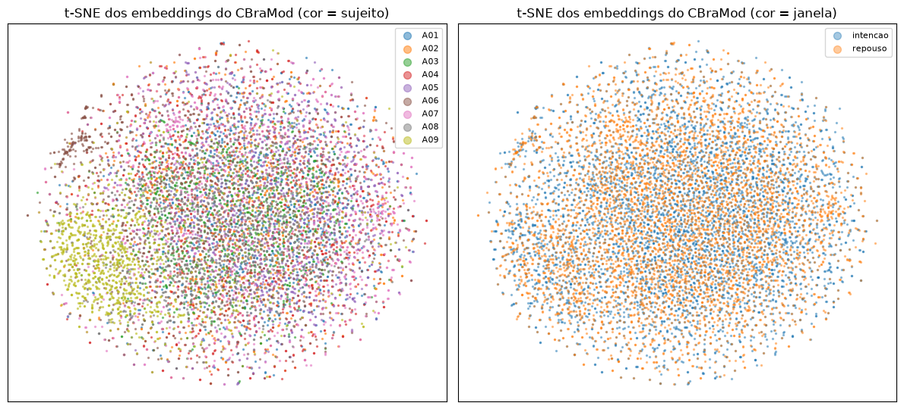

Para separar repouso de intenção, cada trecho de teste recebe a classe da maioria dos seus 10
vizinhos. Essa votação fica abaixo dos dois modelos da Tarefa 4:


Azul: trecho de teste. Laranja: o vizinho mais parecido no treino. Na primeira fileira, um repouso
tem como vizinho uma intenção: parecido para o modelo não quer dizer mesma classe.

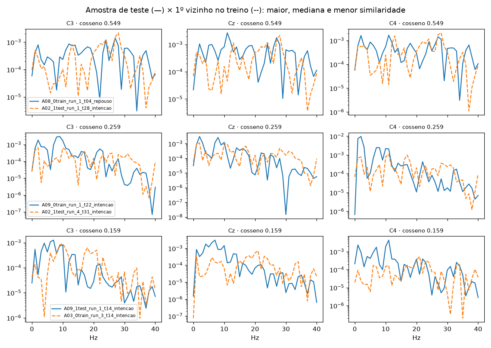

**Conclusões:**

- Não há cópias entre treino e teste, então os resultados da Tarefa 4 não foram inflados.
- O modelo reconhece **de quem é o sinal** (impressão digital cerebral), o que explica a queda da Tarefa 4.
- O modelo não reconhece a intenção: foi pré-treinado sem saber o que a pessoa fazia e usado congelado.
